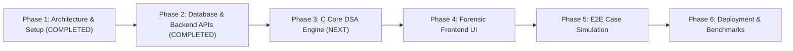

# CASETHREAD – Development Roadmap

This document outlines the phased engineering milestones for **CASETHREAD – Evidence Gap Detection & Investigation Intelligence System**.

---

## Roadmap Overview

---

## Phase Breakdown

### Phase 1: Project Initialization & System Architecture (COMPLETED)
- [x] Inspect existing repository structure.
- [x] Design 5-tier architecture (React, Node.js, C Core Engine, MySQL, Docker).
- [x] Define Node.js to C IPC strategy (Standard I/O JSON streams with timeout safeguards).
- [x] Design 10-table normalized MySQL schema with seed data.
- [x] Structure C engine modular directories (`hashmap`, `trees`, `graphs`, `algorithms`).
- [x] Draft C header contracts with Big-O complexity specifications.
- [x] Create comprehensive `.gitignore`, `README.md`, `docker-compose.yml`, and environment templates.
- [x] Setup baseline code scaffolds across frontend, backend, and core engine.

---

### Phase 2: Database Design and Backend Development (COMPLETED)
*Objective: Build relational MySQL schema and complete RESTful MVC backend.*
- [x] **Database Schema (`database/schema.sql`)**:
  - Relational schema for `officers`, `cases`, `suspects`, `victims`, `witnesses`, `evidence`, `evidence_relationships`, `investigation_timelines`, `investigation_leads`, and `evidence_audit_logs`.
  - Referential integrity via primary and foreign keys (`ON DELETE CASCADE` / `RESTRICT`).
  - Strict distinction between `CONFIRMED_FACT`, `UNVERIFIED_OBSERVATION`, and `HYPOTHESIS`.
  - Comprehensive performance indexing on status, dates, and search identifiers.
  - Immutable audit trail preserving before/after state on evidence mutations.
- [x] **Database Connection (`backend/database/connection.js`)**:
  - `mysql2/promise` connection pool with automatic keepalive and ping diagnostics.
  - Parameterized SQL execution wrapper with transaction support.
  - Built-in fallback in-memory store for offline automated integration testing.
- [x] **Security & Authentication**:
  - Detective badge number registration with bcrypt password hashing (12 salt rounds).
  - JWT issuance (12-hour expiration) with role-based access control.
  - Parameterized queries neutralizing SQL injection vectors.
  - Comprehensive input sanitization with `express-validator`.
- [x] **Modular RESTful MVC Services & Controllers**:
  - Authentication: `/api/v1/auth` (`register`, `login`, `profile`)
  - Case Management: `/api/v1/cases` (`create`, `list`, `getById`, `update`, `archive`, `people`)
  - People Management: Suspects, victims, witnesses endpoints
  - Evidence Management: `/api/v1/evidence` (provenance, audit logging, keyword search, relationships)
  - Chronological Timelines: `/api/v1/timeline` (event tracking, chronological ordering)
  - Investigation Leads: `/api/v1/leads` (priority scoring, status transitions)
  - C Engine Bridge Preparation: `cEngineService.js` (IPC JSON streaming via child process)
- [x] **Comprehensive Automated Testing**:
  - Built-in test suite (`backend/tests/integration.test.js`) covering 28 test cases across 8 suites (100% passing).

---

### Phase 3: C Core DSA Engine Implementation & Unit Testing (NEXT)
*Objective: Build and verify custom data structures and forensic algorithms in pure C.*

#### Milestone 3.1: Separate-Chaining Hash Map
- Implement `hashmap_create`, `hashmap_put`, `hashmap_get`, `hashmap_remove`, and `hashmap_destroy`.
- DJB2 / FNV-1a hashing function with dynamic capacity resizing at load factor $\ge 0.75$.
- Unit test suite (`tests/test_hashmap.c`) verifying collision handling, search, and boundary limits.
- Target Complexity: Average $O(1)$ lookup and insertion.

#### Milestone 3.2: Self-Balancing AVL Tree
- Implement AVL tree with rotation logic (Left, Right, Left-Right, Right-Left) maintaining balance factor in $[-1, 1]$.
- In-order traversal yielding ordered temporal events.
- Range query function: retrieve all timeline incidents occurring between timestamp $t_1$ and $t_2$.
- Unit test suite (`tests/test_tree.c`) with edge-case unbalanced sequence insertions.
- Target Complexity: Guaranteed $O(\log N)$ search/insertion, $O(\log N + K)$ range queries.

#### Milestone 3.3: Adjacency-List Evidence Graph & Traversals
- Dynamic adjacency-list graph supporting typed vertices (suspect, vehicle, CCTV, location) and weighted edges.
- Breadth-First Search (BFS): Shortest associative link discovery between entities.
- Depth-First Search (DFS): Cycle detection (circular contradictions) and connected component clustering.
- Unit test suite (`tests/test_graph.c`) on complex multi-hop evidence graphs.
- Target Complexity: $O(V + E)$ traversal time.

#### Milestone 3.4: Forensic Intelligence Reasoning Modules
- **Evidence Gap Detection:** Identifies isolated high-priority entities, missing corroborating sightings, and chain-of-custody breaks.
- **Timeline Anomaly Analyzer:** Identifies impossible physical travel velocities between consecutive sightings.
- **Priority Lead Generator:** Employs a Max-Heap to rank investigative actions by composite priority score.

#### Milestone 3.5: IPC JSON Serialization & CLI Driver
- Integrate lightweight JSON parsing (`cJSON`) to deserialize input from `stdin` and serialize output to `stdout`.
- Verify memory leak freedom using Valgrind / AddressSanitizer.

---

### Phase 4: Forensic Frontend UI/UX & Evidence Relationship Visualization (Completed)
*Objective: Deliver a dark-themed, high-density digital investigation dashboard in React with full C-Engine graph visualization.*
- **C-Engine Relationship Engine:** Discovers direct and data-derived relationships (`SAME_LOCATION`, `SAME_VEHICLE`, `SHARED_PHONE`, `SHARED_CONTACT`, `SAME_PHYSICAL_EVIDENCE`, `WITNESS_ASSOCIATION`).
- **Graph Analysis Traversals:** BFS shortest path discovery between entities, DFS connected component clustering, and neighborhood exploration.
- **Backend Graph API (`/api/v1/cases/:id/graph`):** 8 REST endpoints for graph topology, nodes, edges, shortest paths, neighborhood exploration, connected components, and isolated leads.
- **Interactive Graph Canvas (`GraphCanvas.js`):** Force-directed physics layout, zoom/pan, node dragging, entity color-coding, edge styling by origin, and golden path illumination.
- **Investigation Workspace (`GraphAnalysis.js`):** Case selector, metrics ribbon, entity/origin filters, BFS shortest path trace tool, cluster highlighter, and inspector drawer.

---

### Phase 5: Timeline Analysis, Verification Requirements & Scenario Simulation
*Objective: Validate the entire platform against realistic investigative scenarios and timeline contradictions.*
- Simulation of "The Metro Vault Intrusion & Disappearance" case.
- Verification of gap detection, timeline contradiction identification, and lead accuracy.

---

### Phase 6: Containerization, Performance Benchmarking & Academic Documentation
*Objective: Production readiness, automated deployment, and academic deliverables.*
- Multi-container deployment verification with `docker-compose up`.
- Empirical Big-O benchmarks: measure C engine execution latency and RAM consumption.
- Final academic report and documentation.
