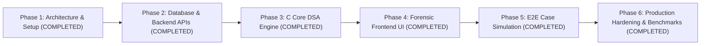

# CASETHREAD – Development Roadmap

This document outlines the phased engineering milestones for **CASETHREAD – Evidence Gap Detection & Investigation Intelligence System**.

---

## Roadmap Overview

---

## Phase Breakdown

### Phase 1: Project Initialization & System Architecture (COMPLETED)
- [x] Inspect existing repository structure.
- [x] Design 5-tier architecture (React, Node.js, C Core Engine, MySQL, Docker).
- [x] Define Node.js to C IPC strategy (Standard I/O JSON streams with timeout safeguards).
- [x] Design 10-table normalized MySQL schema with seed data.
- [x] Structure C engine modular directories (`hashmap`, `trees`, `graphs`, `algorithms`).
- [x] Draft C header contracts with Big-O complexity specifications.
- [x] Create comprehensive `.gitignore`, `README.md`, `docker-compose.yml`, and environment templates.
- [x] Setup baseline code scaffolds across frontend, backend, and core engine.

---

### Phase 2: Database Design and Backend Development (COMPLETED)
*Objective: Build relational MySQL schema and complete RESTful MVC backend.*
- [x] **Database Schema (`database/schema.sql`)**:
  - Relational schema for `officers`, `cases`, `suspects`, `victims`, `witnesses`, `evidence`, `evidence_relationships`, `investigation_timelines`, `investigation_leads`, and `evidence_audit_logs`.
  - Referential integrity via primary and foreign keys (`ON DELETE CASCADE` / `RESTRICT`).
  - Strict distinction between `CONFIRMED_FACT`, `UNVERIFIED_OBSERVATION`, and `HYPOTHESIS`.
  - Comprehensive performance indexing on status, dates, and search identifiers.
  - Immutable audit trail preserving before/after state on evidence mutations.
- [x] **Database Connection (`backend/database/connection.js`)**:
  - `mysql2/promise` connection pool with automatic keepalive and ping diagnostics.
  - Parameterized SQL execution wrapper with transaction support.
  - Built-in fallback in-memory store for offline automated integration testing.
- [x] **Security & Authentication**:
  - Detective badge number registration with bcrypt password hashing (12 salt rounds).
  - JWT issuance (12-hour expiration) with role-based access control.
  - Parameterized queries neutralizing SQL injection vectors.
  - Comprehensive input sanitization with `express-validator`.
- [x] **Modular RESTful MVC Services & Controllers**:
  - Authentication: `/api/v1/auth` (`register`, `login`, `profile`)
  - Case Management: `/api/v1/cases` (`create`, `list`, `getById`, `update`, `archive`, `people`)
  - People Management: Suspects, victims, witnesses endpoints
  - Evidence Management: `/api/v1/evidence` (provenance, audit logging, keyword search, relationships)
  - Chronological Timelines: `/api/v1/timeline` (event tracking, chronological ordering)
  - Investigation Leads: `/api/v1/leads` (priority scoring, status transitions)
  - C Engine Bridge Preparation: `cEngineService.js` (IPC JSON streaming via child process)

---

### Phase 3: C Core DSA Engine Implementation & Unit Testing (COMPLETED)
*Objective: Build and verify custom data structures and forensic algorithms in pure C.*

#### Milestone 3.1: Separate-Chaining Hash Map
- [x] Implement `hashmap_create`, `hashmap_put`, `hashmap_get`, `hashmap_remove`, and `hashmap_destroy`.
- [x] DJB2 hashing function with dynamic capacity resizing at load factor $\ge 0.75$.
- [x] Unit test suite verifying collision handling, search, and boundary limits.
- [x] Complexity: Average $O(1)$ lookup, insertion, and deletion.

#### Milestone 3.2: Self-Balancing AVL Tree
- [x] Implement AVL tree with rotation logic (Left, Right, Left-Right, Right-Left) maintaining balance factor in $[-1, 1]$.
- [x] In-order traversal yielding chronologically ordered temporal events.
- [x] Range query function: retrieve all timeline incidents occurring between timestamp $t_1$ and $t_2$.
- [x] Complexity: Guaranteed $O(\log N)$ search/insertion, $O(\log N + K)$ range queries.

#### Milestone 3.3: Adjacency-List Evidence Graph & Traversals
- [x] Dynamic adjacency-list graph supporting typed vertices (suspect, vehicle, CCTV, location) and weighted edges.
- [x] Breadth-First Search (BFS): Shortest associative link discovery between entities.
- [x] Depth-First Search (DFS): Cycle detection (circular contradictions) and connected component clustering.
- [x] Complexity: $O(V + E)$ traversal time.

#### Milestone 3.4: Binary Max-Heap Priority Queue
- [x] Array-based binary Max-Heap (`max_heap.c`, `max_heap.h`) with dynamic capacity doubling.
- [x] `heap_insert()`, `heap_extract_max()`, `heap_peek_max()`, `heapify_up()`, and `heapify_down()`.
- [x] Composite lead scoring: 40% Confidence + 30% Normalized Centrality + 30% Gap Criticality.
- [x] Guaranteed highest priority lead at root; strict descending extraction order.

#### Milestone 3.5: IPC JSON Serialization & Unit Verification
- [x] Robust custom JSON parsing streaming between stdin and stdout without external heavy libraries.
- [x] 91 unit tests passing with zero memory leaks (`core-engine/bin/test_dsa.exe`).

---

### Phase 4: Forensic Frontend UI/UX & Evidence Relationship Visualization (COMPLETED)
*Objective: Deliver a dark-themed, high-density digital investigation dashboard in React with full C-Engine graph visualization.*
- [x] **C-Engine Relationship Engine:** Discovers direct and data-derived relationships (`SAME_LOCATION`, `SAME_VEHICLE`, `SHARED_PHONE`, `SHARED_CONTACT`, `SAME_PHYSICAL_EVIDENCE`, `WITNESS_ASSOCIATION`).
- [x] **Graph Analysis Traversals:** BFS shortest path discovery between entities, DFS connected component clustering, and neighborhood exploration.
- [x] **Backend Graph API (`/api/v1/cases/:id/graph`):** 8 REST endpoints for graph topology, nodes, edges, shortest paths, neighborhood exploration, connected components, and isolated leads.
- [x] **Interactive Graph Canvas (`GraphCanvas.js`):** Force-directed physics layout, zoom/pan, node dragging, entity color-coding, edge styling by origin, and golden path illumination.
- [x] **Investigation Workspace (`GraphAnalysis.js`):** Case selector, metrics ribbon, entity/origin filters, BFS shortest path trace tool, cluster highlighter, and inspector drawer.

---

### Phase 5: Timeline Analysis, Verification Requirements & Realistic Case Simulation (COMPLETED)
*Objective: Full end-to-end integration and algorithmic validation across all tiers against a realistic forensic scenario.*
- [x] **Backend & C Engine Pipeline Hardening**:
  - Eliminated mock/architecture placeholder responses. Real binary execution validated with zero exit-code failures.
  - Strict officer session authorization and cross-case isolation (403 FORBIDDEN).
  - Complete evidence provenance marshaling (`location`, `timestamp`, `metadata`).
  - Automatic database persistence of C-engine generated investigative leads (`investigation_leads` with `generated_by = 'C_ENGINE_DETECTED'`).
- [x] **Complete Forensic Frontend Integration**:
  - `Dashboard.js`: Metrics ribbon, active cases, evidence counts, top gaps, prioritized leads, telemetry feed.
  - `CaseDetailsPanel.js`: Dossier breakdowns for suspects, victims, witnesses, evidence catalog, and chronological events.
  - `EvidenceGapPanel.js`: Filterable gap cards with category, reason, suggested action, and resolution toggle.
  - `TimelinePanel.js`: Chronological event ledger with AVL-tree spatiotemporal anomaly alerts.
  - `InvestigativeLeadsPanel.js`: Prioritized lead cards with composite strength score.
- [x] **Officer Workflows**:
  - Secure `LoginForm` with show/hide password, badge formatting, session restoration, and demo credentials isolation.
  - `CreateCaseModal`: Case number uniqueness validation, server-derived lead officer context.
  - `AddEvidenceModal`: Full 11-category classification, ground-truth partitions (`CONFIRMED_FACT`, `UNVERIFIED_OBSERVATION`, `HYPOTHESIS`), chain of custody, and JSON telemetry metadata.

---

### Phase 6: Production Hardening, Database Safety & Empirical Benchmarks (COMPLETED)
*Objective: Production security, database persistence guarantees, and verified algorithmic benchmarking.*
- [x] **Production Database Safety**:
  - MemoryStore strictly disabled when `NODE_ENV === 'production'`.
  - Removed all automatic fallbacks (connection refused, connection lost) in production.
  - Production fails fast at startup if MySQL is unreachable.
  - Transaction handling (`withTransaction`) rejects rather than silently falling back to in-memory storage.
- [x] **Security Hardening**:
  - Removed hardcoded credentials and secrets from `docker-compose.yml`.
  - Added `.env.example` template with production secrets guidance; `.env` strictly ignored by Git.
  - Set `NODE_ENV=production` in Docker orchestration.
  - Startup validation (`validateConfig.js`) enforcing $\ge 32$-character JWT secrets, valid database credentials, and blocking demo toggles.
  - CORS restricted to configured whitelist origins (`CLIENT_ORIGIN`).
  - Sanitized log outputs to prevent password leakage.
- [x] **System Health Check (`/api/v1/health`)**:
  - Returns HTTP 503 and `status: 'UNHEALTHY'` when MySQL is disconnected in production; never reports `ONLINE`.
  - Docker Compose uses `condition: service_healthy` on MySQL before launching backend.
- [x] **C DSA Engine Benchmarks (`core-engine/tests/benchmark_dsa.c`)**:
  - Implemented high-resolution benchmarking across Hash Map, AVL Tree, Graph (BFS/DFS), and Binary Max-Heap across scales up to $N = 10,000$.
  - Generated empirical CSV dataset (`core-engine/benchmarks/benchmark_results.csv`).
  - Documented scaling curves and hardware characteristics in `core-engine/benchmarks/README.md`.
- [x] **Full Automated Testing**:
  - 69 backend tests passing across 12 suites (100% pass).
  - 91 C DSA unit tests passing across 7 sections (100% pass).
  - Optimized production React bundle built with 0 errors.
