# CASETHREAD – Development Roadmap

This document outlines the phased engineering milestones for **CASETHREAD – Evidence Gap Detection & Investigation Intelligence System**.

---

## Roadmap Overview

```mermaid
flowchart LR
    P1["Phase 1: Architecture & Setup (COMPLETED)"] --> P2["Phase 2: Database & Backend APIs (COMPLETED)"]
    P2 --> P3["Phase 3: C Core DSA Engine (COMPLETED)"]
    P3 --> P4["Phase 4: Forensic Frontend UI (COMPLETED)"]
    P4 --> P5["Phase 5: E2E Case Simulation (COMPLETED)"]
    P5 --> P6["Phase 6: Production Hardening & Benchmarks (COMPLETED)"]
    P6 --> P7["Phase 7: Forensic Integrity & Explainable AI (COMPLETED)"]
    P7 --> P8["Phase 8: Secure File Vault & Multi-Format Ingestion (COMPLETED)"]
    P8 --> P9["Phase 9: Geospatial Intelligence & Interactive Mapping (COMPLETED)"]
```

---

## Phase Breakdown

### Phase 1: Project Initialization & System Architecture (COMPLETED)
- [x] Inspect existing repository structure.
- [x] Design 5-tier architecture (React, Node.js, C Core Engine, MySQL, Docker).
- [x] Define Node.js to C IPC strategy (Standard I/O JSON streams with timeout safeguards).
- [x] Design 10-table normalized MySQL schema with seed data.
- [x] Structure C engine modular directories (`hashmap`, `trees`, `graphs`, `algorithms`).
- [x] Draft C header contracts with Big-O complexity specifications.
- [x] Create comprehensive `.gitignore`, `README.md`, `docker-compose.yml`, and environment templates.
- [x] Setup baseline code scaffolds across frontend, backend, and core engine.

---

### Phase 2: Database Design and Backend Development (COMPLETED)
*Objective: Build relational MySQL schema and complete RESTful MVC backend.*
- [x] **Database Schema (`database/schema.sql`)**:
  - Relational schema for `officers`, `cases`, `suspects`, `victims`, `witnesses`, `evidence`, `evidence_relationships`, `investigation_timelines`, `investigation_leads`, and `evidence_audit_logs`.
  - Referential integrity via primary and foreign keys (`ON DELETE CASCADE` / `RESTRICT`).
  - Strict distinction between `CONFIRMED_FACT`, `UNVERIFIED_OBSERVATION`, and `HYPOTHESIS`.
  - Comprehensive performance indexing on status, dates, and search identifiers.
  - Immutable audit trail preserving before/after state on evidence mutations.
- [x] **Database Connection (`backend/database/connection.js`)**:
  - `mysql2/promise` connection pool with automatic keepalive and ping diagnostics.
  - Parameterized SQL execution wrapper with transaction support.
  - Built-in fallback in-memory store for offline automated integration testing.
- [x] **Security & Authentication**:
  - Detective badge number registration with bcrypt password hashing (12 salt rounds).
  - JWT issuance (12-hour expiration) with role-based access control.
  - Parameterized queries neutralizing SQL injection vectors.
  - Comprehensive input sanitization with `express-validator`.
- [x] **Modular RESTful MVC Services & Controllers**:
  - Authentication: `/api/v1/auth` (`register`, `login`, `profile`)
  - Case Management: `/api/v1/cases` (`create`, `list`, `getById`, `update`, `archive`, `people`)
  - People Management: Suspects, victims, witnesses endpoints
  - Evidence Management: `/api/v1/evidence` (provenance, audit logging, keyword search, relationships)
  - Chronological Timelines: `/api/v1/timeline` (event tracking, chronological ordering)
  - Investigation Leads: `/api/v1/leads` (priority scoring, status transitions)
  - C Engine Bridge Preparation: `cEngineService.js` (IPC JSON streaming via child process)

---

### Phase 3: C Core DSA Engine Implementation & Unit Testing (COMPLETED)
*Objective: Build and verify custom data structures and forensic algorithms in pure C.*

#### Milestone 3.1: Separate-Chaining Hash Map
- [x] Implement `hashmap_create`, `hashmap_put`, `hashmap_get`, `hashmap_remove`, and `hashmap_destroy`.
- [x] DJB2 hashing function with dynamic capacity resizing at load factor $\ge 0.75$.
- [x] Unit test suite verifying collision handling, search, and boundary limits.
- [x] Complexity: Average $O(1)$ lookup, insertion, and deletion.

#### Milestone 3.2: Self-Balancing AVL Tree
- [x] Implement AVL tree with rotation logic (Left, Right, Left-Right, Right-Left) maintaining balance factor in $[-1, 1]$.
- [x] In-order traversal yielding chronologically ordered temporal events.
- [x] Range query function: retrieve all timeline incidents occurring between timestamp $t_1$ and $t_2$.
- [x] Complexity: Guaranteed $O(\log N)$ search/insertion, $O(\log N + K)$ range queries.

#### Milestone 3.3: Adjacency-List Evidence Graph & Traversals
- [x] Dynamic adjacency-list graph supporting typed vertices (suspect, vehicle, CCTV, location) and weighted edges.
- [x] Breadth-First Search (BFS): Shortest associative link discovery between entities.
- [x] Depth-First Search (DFS): Cycle detection (circular contradictions) and connected component clustering.
- [x] Complexity: $O(V + E)$ traversal time.

#### Milestone 3.4: Binary Max-Heap Priority Queue
- [x] Array-based binary Max-Heap (`max_heap.c`, `max_heap.h`) with dynamic capacity doubling.
- [x] `heap_insert()`, `heap_extract_max()`, `heap_peek_max()`, `heapify_up()`, and `heapify_down()`.
- [x] Composite lead scoring: 40% Confidence + 30% Normalized Centrality + 30% Gap Criticality.
- [x] Guaranteed highest priority lead at root; strict descending extraction order.

#### Milestone 3.5: IPC JSON Serialization & Unit Verification
- [x] Robust custom JSON parsing streaming between stdin and stdout without external heavy libraries.
- [x] 91 unit tests passing with zero memory leaks (`core-engine/bin/test_dsa.exe`).

---

### Phase 4: Forensic Frontend UI/UX & Evidence Relationship Visualization (COMPLETED)
*Objective: Deliver a dark-themed, high-density digital investigation dashboard in React with full C-Engine graph visualization.*
- [x] **C-Engine Relationship Engine:** Discovers direct and data-derived relationships (`SAME_LOCATION`, `SAME_VEHICLE`, `SHARED_PHONE`, `SHARED_CONTACT`, `SAME_PHYSICAL_EVIDENCE`, `WITNESS_ASSOCIATION`).
- [x] **Graph Analysis Traversals:** BFS shortest path discovery between entities, DFS connected component clustering, and neighborhood exploration.
- [x] **Backend Graph API (`/api/v1/cases/:id/graph`):** 8 REST endpoints for graph topology, nodes, edges, shortest paths, neighborhood exploration, connected components, and isolated leads.
- [x] **Interactive Graph Canvas (`GraphCanvas.js`):** Force-directed physics layout, zoom/pan, node dragging, entity color-coding, edge styling by origin, and golden path illumination.
- [x] **Investigation Workspace (`GraphAnalysis.js`):** Case selector, metrics ribbon, entity/origin filters, BFS shortest path trace tool, cluster highlighter, and inspector drawer.

---

### Phase 5: Timeline Analysis, Verification Requirements & Realistic Case Simulation (COMPLETED)
*Objective: Full end-to-end integration and algorithmic validation across all tiers against a realistic forensic scenario.*
- [x] **Backend & C Engine Pipeline Hardening**:
  - Eliminated mock/architecture placeholder responses. Real binary execution validated with zero exit-code failures.
  - Strict officer session authorization and cross-case isolation (403 FORBIDDEN).
  - Complete evidence provenance marshaling (`location`, `timestamp`, `metadata`).
  - Automatic database persistence of C-engine generated investigative leads (`investigation_leads` with `generated_by = 'C_ENGINE_DETECTED'`).
- [x] **Complete Forensic Frontend Integration**:
  - `Dashboard.js`: Metrics ribbon, active cases, evidence counts, top gaps, prioritized leads, telemetry feed.
  - `CaseDetailsPanel.js`: Dossier breakdowns for suspects, victims, witnesses, evidence catalog, and chronological events.
  - `EvidenceGapPanel.js`: Filterable gap cards with category, reason, suggested action, and resolution toggle.
  - `TimelinePanel.js`: Chronological event ledger with AVL-tree spatiotemporal anomaly alerts.
  - `InvestigativeLeadsPanel.js`: Prioritized lead cards with composite strength score.
- [x] **Officer Workflows**:
  - Secure `LoginForm` with show/hide password, badge formatting, session restoration, and demo credentials isolation.
  - `CreateCaseModal`: Case number uniqueness validation, server-derived lead officer context.
  - `AddEvidenceModal`: Full 11-category classification, ground-truth partitions (`CONFIRMED_FACT`, `UNVERIFIED_OBSERVATION`, `HYPOTHESIS`), chain of custody, and JSON telemetry metadata.

---

### Phase 6: Production Hardening, Database Safety & Empirical Benchmarks (COMPLETED)
*Objective: Production security, database persistence guarantees, and verified algorithmic benchmarking.*
- [x] **Production Database Safety**:
  - MemoryStore strictly disabled when `NODE_ENV === 'production'`.
  - Removed all automatic fallbacks (connection refused, connection lost) in production.
  - Production fails fast at startup if MySQL is unreachable.
  - Transaction handling (`withTransaction`) rejects rather than silently falling back to in-memory storage.
- [x] **Security Hardening**:
  - Removed hardcoded credentials and secrets from `docker-compose.yml`.
  - Added `.env.example` template with production secrets guidance; `.env` strictly ignored by Git.
  - Set `NODE_ENV=production` in Docker orchestration.
  - Startup validation (`validateConfig.js`) enforcing $\ge 32$-character JWT secrets, valid database credentials, and blocking demo toggles.
  - CORS restricted to configured whitelist origins (`CLIENT_ORIGIN`).
  - Sanitized log outputs to prevent password leakage.
- [x] **System Health Check (`/api/v1/health`)**:
  - Returns HTTP 503 and `status: 'UNHEALTHY'` when MySQL is disconnected in production; never reports `ONLINE`.
  - Docker Compose uses `condition: service_healthy` on MySQL before launching backend.
- [x] **C DSA Engine Benchmarks (`core-engine/tests/benchmark_dsa.c`)**:
  - Implemented high-resolution benchmarking across Hash Map, AVL Tree, Graph (BFS/DFS), and Binary Max-Heap across scales up to $N = 10,000$.
  - Generated empirical CSV dataset (`core-engine/benchmarks/benchmark_results.csv`).
  - Documented scaling curves and hardware characteristics in `core-engine/benchmarks/README.md`.
- [x] **Full Automated Testing**:
  - 69 backend tests passing across 12 suites (100% pass).
  - 91 C DSA unit tests passing across 7 sections (100% pass).
  - Optimized production React bundle built with 0 errors.

---

### Phase 7: Forensic Evidence Integrity & Explainable Investigation Intelligence (COMPLETED)
*Objective: Upgrade CASETHREAD from an evidence relationship and gap-detection application into a reliable forensic investigation-support platform with cryptographic verification, provenance tracking, and explainable decision support.*

- [x] **Cryptographic Evidence Fingerprinting (`backend/services/cryptoService.js`)**:
  - Automated SHA-256 fingerprint generation distinguishing raw content payload (`CONTENT_SHA256`) vs canonical metadata snapshot (`METADATA_CANONICAL`).
  - Bit-level verification endpoint (`POST /api/v1/evidence/:id/verify-integrity`).
  - Verification logging table (`evidence_integrity_verifications`) recording timestamp, officer, result, and calculated hash.
  - Automatic detection and flagging of modified records (`TAMPERED_MISMATCH` vs `INTACT`).
- [x] **Chain-of-Custody Event Tracking (`backend/controllers/custodyController.js`)**:
  - Auditable custody event workflow recorded in `evidence_custody_events`.
  - Chronological provenance tracking with mandatory transferred-from and transferred-to officer fields, transfer purpose, and destination location.
  - Case-level access isolation (HTTP 403 for unauthorized cross-case transfers).
- [x] **Tamper-Evident Audit Hash Chaining (`cryptoService.js` & `evidence_audit_logs`)**:
  - Backward-linked cryptographic audit hash chain linking each event to `previous_event_hash` starting from `GENESIS_HASH`.
  - Cryptographic verification algorithm (`cryptoService.verifyAuditChain`) detecting payload modification, event omission, and chronological reordering.
  - Audit chain verification endpoints (`GET /api/v1/evidence/:id/audit-chain` and `POST /api/v1/evidence/:id/audit-chain/verify`).
- [x] **Evidence Version Management (`evidence_versions`)**:
  - Version history preservation: creates Version 1 baseline on evidence creation and increments to $V(N+1)$ on modification.
  - Preserves prior metadata snapshot, modification reason, timestamp, and modifying officer ID.
  - Version inspection endpoint (`GET /api/v1/evidence/:id/versions`).
- [x] **Explainable Algorithm-Generated Findings (`analysisController.js`)**:
  - Enriched C DSA analysis output with explicit structured explainability blocks.
  - Categorized findings (`MISSING_METADATA_GAP`, `SPATIOTEMPORAL_TRAJECTORY_ANOMALY`, `HEURISTIC_INVESTIGATIVE_HYPOTHESIS`).
  - Score calculation breakdowns ("40% Confidence + 30% Centrality + 30% Criticality").
  - Clear statements of algorithm rules, known limitations, and academic decision-support disclaimers.
- [x] **Verification & Integrity Dashboard (Frontend)**:
  - `EvidenceIntegrityPanel.js`: Interactive evidence table with SHA-256 fingerprint pills, integrity badges, and quick copy utilities.
  - Forensic Overview Metrics: Total Evidence, Fingerprinted, Verified Intact, Integrity Alerts, Awaiting Verification.
  - Audit Chain Modal: Visualizes backward-linking SHA-256 event chains and head event hash.
  - Version History Modal: Compares V1 vs V2+ revisions and officer modification reasons.
  - Chain-of-Custody Drawer: Full chronological event timeline and custody transfer form.
  - Explainability cards integrated into `EvidenceGapPanel.js` and `InvestigativeLeadsPanel.js`.
- [x] **Structured Case Report Generation & Export (`reportController.js`)**:
  - Structured machine-readable JSON export (`/api/v1/reports/cases/:caseId/json`).
  - Printable official HTML/PDF dossier (`/api/v1/reports/cases/:caseId/html`) with law-enforcement typography, official seals, print stylesheet pagination, and zero credential leakage.
  - Case isolation enforcement preventing unauthorized cross-officer report generation.
- [x] **Comprehensive Automated Verification (`backend/tests/forensic_integrity.test.js`)**:
  - 16 new automated forensic integrity tests (100% pass).
  - Complete backend test suite: **85 passing tests across 13 suites** with zero failures.
  - Production React build compiled successfully with 0 errors (75.01 kB gzipped).

---

### Phase 8: Digital Evidence Acquisition, Secure File Vault & Multi-Format Ingestion (COMPLETED)
*Objective: Connect physical digital evidence files (documents, images, audio, video, structured records) to existing Phase 7 integrity workflows, establishing a tamper-evident storage vault, automated format-aware metadata extraction, and derived artifact lifecycle management.*

- [x] **Stage 0: Repository Audit & Gap Analysis**:
  - Validated existing database schema, memory store, and Phase 7 integrity architecture.
  - Formulated schema extensions (`evidence_files`, `evidence_metadata_extractions`, `evidence_derived_artifacts`) avoiding duplication.
- [x] **Stage 1: Secure Evidence File Acquisition (`backend/services/vaultService.js`)**:
  - Implemented multipart file uploads with `multer` memory storage.
  - Strict 50MB file size cap preventing denial-of-service ingestion.
  - Binary magic-byte signature validation (PDF, PNG, JPEG, MP4, WAV, MP3, CSV, TXT, JSON, XML) neutralizing MIME spoofing attacks.
  - Sanitized filenames and UUIDv4 storage keys (`storage_key = <uuid>_<clean_filename>`).
  - Path traversal defense preventing directory escape vectors (`..`, `\0`, absolute paths).
- [x] **Stage 2: Secure File Vault & Storage Management (`backend/services/vaultService.js`)**:
  - Persistent storage directories outside public web root (`storage/vault/cases/<caseId>/originals/` and `storage/vault/cases/<caseId>/artifacts/`).
  - Docker volume mount (`evidence_vault:/app/storage/vault`) ensuring persistence across container redeployments.
  - Streamed, byte-range capable file downloads and media preview endpoints.
  - Case-level access isolation restricting downloads to assigned lead officers.
  - Missing file and tampering detection at the disk filesystem layer.
- [x] **Stage 3: Integration with Phase 7 Cryptographic Integrity (`cryptoService.js`)**:
  - Chunked 64KB streaming SHA-256 calculation (`cryptoService.calculateFileSha256`).
  - Storage of content hash in `evidence_files.sha256_hash` and `evidence.sha256_fingerprint`.
  - Live disk verification comparing physical bytes with cryptographic ledger records.
  - Logging of verification operations in `evidence_integrity_verifications`.
- [x] **Stage 4: Automated Format-Aware Metadata Extraction (`metadataExtractor.js`)**:
  - **Images (PNG, JPEG):** Extracted dimensions, color depth, EXIF metadata, camera make/model, ISO, exposure, and GPS geolocation coordinates.
  - **Documents (PDF):** Extracted page count, title, author, creation date, and PDF specification version.
  - **Audio (WAV, MP3):** Extracted duration, sample rate, channels, bitrate, and MPEG frame headers.
  - **Video (MP4):** Extracted frame dimensions, duration, time scale, codec tags (`avc1`, `mp4a`), and ISO base media box atoms.
  - **Data Records (CSV, JSON, XML, TXT):** Extracted encoding, line/record counts, headers, column counts, and top-level schema keys.
- [x] **Stage 5: Evidence Classification & Normalization**:
  - Structured extraction mapping stored in `evidence_metadata_extractions`.
  - Officer review and acceptance workflow (`POST /api/v1/vault/extractions/:id/review`).
  - Strict preservation of `CONFIRMED_FACT` vs `UNVERIFIED_OBSERVATION` boundaries; manual officer observations are never silently overwritten.
- [x] **Stage 6: Derived Forensic Artifact Management (`artifactService.js`)**:
  - Controlled generation of derived research artifacts (`EXTRACTED_TEXT`, `NORMALIZED_DATA`, `PREVIEW_IMAGE`).
  - Independent SHA-256 fingerprinting for each derived artifact.
  - Parent-child lineage tracking linking derived artifacts back to original evidence files without modifying original media.
- [x] **Stage 7 & 8: Evidence Vault UI & Search Filtering (`EvidenceVaultPanel.js`)**:
  - Modern React evidence vault interface with drag-and-drop ingestion dropzone and upload progress bar.
  - Multi-parameter search and filtering (case, category, format, integrity status, officer).
  - Inspection drawer displaying complete technical metadata, EXIF details, and GPS coordinates.
  - In-browser media preview player supporting images, PDF documents, video, and audio.
  - On-demand derived artifact generation and secure download actions.
- [x] **Stage 9: Quality Assurance & Automated Test Suite (`tests/evidence_vault.test.js`)**:
  - 22 dedicated automated test cases verifying file upload, magic bytes, MIME spoofing rejection, oversized file rejection, path traversal protection, downloads, media previews, integrity verification, tampering detection, missing file handling, derived artifacts, officer extraction reviews, search filters, and JSON report dossier integration.
  - Full platform test suite: **107 passing backend tests across 14 suites** (100% pass).
  - Optimized production React build compiled successfully (79.88 kB gzipped).

---

### Phase 9: Geospatial Evidence Intelligence & Interactive Investigation Mapping (COMPLETED)
*Objective: Upgrade CASETHREAD with high-performance geographical evidence indexing and analysis, connecting extracted GPS coordinates, CCTV camera locations, vehicle sightings, and cellular tower relays to a C Quadtree spatial engine and an interactive forensic mapping workspace.*

- [x] **Stage 0: Repository Audit & Spatial Analysis Gap Review**:
  - Audited core engine headers, backend routes, database schemas, and frontend panels.
  - Confirmed Phase 8 EXIF GPS metadata extraction and identified need for normalized spatial schema and C Quadtree indexing.
- [x] **Stage 1: Normalized Geospatial Data Model (`database/schema.sql` & `connection.js`)**:
  - Created `evidence_geospatial` table with WGS84 coordinates, altitude, estimated accuracy radii, location sources (`EXIF_GPS`, `OFFICER_ENTERED`, `CCTV_RECORD`, `CELL_TOWER`, `DMV_RECORD`), and verification status flags.
  - Implemented boundary constraint validations: Latitude $[-90, 90]$, Longitude $[-180, 180]$.
  - Added seeded geospatial points for demo Case 1 in downtown metro financial district.
  - Updated in-memory test store (`connection.js`) with complete SQL handlers.
- [x] **Stage 2: C Quadtree Spatial Index (`core-engine/include/quadtree.h` & `src/spatial/quadtree.c`)**:
  - Implemented 2D hierarchical Quadtree with configurable bucket capacity (default 8) and dynamic subdivision up to depth 24.
  - Geodesic Haversine distance calculations ($R = 6,371,008.8\text{ meters}$) with numerical stability.
  - Implemented spatial candidate bounding box extraction and exact Haversine radius filtering.
  - Robust edge-case handling: duplicate coordinate chaining (`next_duplicate`), boundary coordinate partitioning, polar convergence handling, and antimeridian ($180^\circ / -180^\circ$) longitude wraparound query splitting.
  - Clean memory allocation/deallocation macros with zero leaks.
- [x] **Stage 3: Geospatial Investigation Algorithms (`backend/services/geospatialService.js`)**:
  - **Proximity Search:** Discovers evidence within radius $R$ with distance unit conversion (`km`, `miles`, `feet`, `meters`).
  - **Geographical Clustering:** Density-based connected component clustering discovering spatial groups and isolating single-point outliers.
  - **Shared Location Detection:** Discovers observations sharing coordinates within 25m tolerance.
  - **Spatiotemporal Travel Velocity Analysis:** Calculates minimum theoretical travel speed $v = \frac{d}{\Delta t} \times 3.6\text{ km/h}$ between consecutive observations; flags transitions $> 180\text{ km/h}$ as `SPATIOTEMPORAL_SPEED_ANOMALY`.
  - **Co-Presence Detection:** Identifies distinct evidence items occurring within 100m and 15 minutes of each other.
  - **Judicial Disclaimer Integration:** All findings explicitly disclaim that proximity or location overlap does not prove direct contact, awareness, or criminal guilt.
- [x] **Stage 4: Node.js Backend Integration (`geospatialController.js` & `geospatialRoutes.js`)**:
  - Mounted `/api/v1/cases/:caseId/geospatial` (points, search, clusters, analysis, point creation, review).
  - Mounted `/api/v1/evidence/:evidenceId/location` (evidence location history).
  - Enforced strict case-level isolation rejecting cross-case access with HTTP 403 Forbidden.
- [x] **Stage 5 & 6: Interactive Forensic Map UI (`GeospatialMapPanel.js`)**:
  - Air-gapped Tactical Grid and online basemap provider options.
  - Smooth pan/zoom canvas viewport with coordinates display and fit-bounds reset.
  - Color-coded tactical markers for CCTV, Cell Tower, Vehicle Sightings, and Physical Evidence.
  - Interactive distance caliper measuring great-circle displacement between any two markers.
  - Spatiotemporal timeline scrubber slider with play/pause automatic chronological playback.
  - Observation movement links explicitly tagged with non-transit route disclaimers.
  - Inspection drawer with point details, velocity alert breakdowns, and manual coordinate recording form.
- [x] **Stage 7 & 8: Privacy, Security & Explainability**:
  - Strict local coordinate processing: zero external geocoding of sensitive crime scene coordinates.
  - Standardized explainability cards displaying formulas, limitations, and detective follow-up steps.
- [x] **Stage 9: Automated Unit & Regression Tests**:
  - **C Quadtree Test Suite (`test_quadtree.c`):** 27/27 assertions passing (100%).
  - **Backend Geospatial Test Suite (`geospatial.test.js`):** 15/15 tests passing (100%).
  - **Full Platform Regression Suite:** **122 backend tests across 15 suites** passing (100%).
  - **Full C DSA Suite:** **118 C assertions** across 8 modules passing (100%).
  - **Optimized Frontend Production Build:** React bundle compiled successfully with 0 errors (86.7 kB gzipped).
- [x] **Stage 10: Empirical Performance Benchmarks (`benchmark_quadtree.c`)**:
  - Benchmarked Quadtree vs Linear Scan across $N \in \{100, 500, 1000, 5000, 10000\}$ points.
  - 100% query result parity confirmed between Quadtree and Linear Scan.
  - Demonstrated empirical speedup scaling from $10.77\times$ at $N = 5,000$ to **$17.67\times$ speedup at $N = 10,000$**.
  - Generated empirical dataset saved to `core-engine/benchmarks/quadtree_benchmark_results.csv`.

---

### Phase 10: Multi-Officer Collaboration & Investigation Workflow Management (COMPLETED)
*Objective: Upgrade CASETHREAD from single-lead case management into a collaborative multi-officer investigation workspace with case-level role assignments, investigation task Directed Acyclic Graph (DAG) dependencies with cycle detection, human evidence review queues, activity timelines, notifications, and operational workload analytics.*

- [x] **Stage 0: Repository Audit & Multi-Officer Architecture Review**:
  - Audited existing single-owner case management in `cases` table, role permissions, evidence chain of custody, and vault architecture.
  - Designed normalized relational extensions across 7 new tables (`case_members`, `investigation_tasks`, `investigation_task_notes`, `investigation_task_dependencies`, `evidence_reviews`, `case_activity_logs`, `officer_notifications`) without breaking backward compatibility.
- [x] **Stage 1: Multi-Officer Case Access & Role Matrix (`case_members`)**:
  - Established normalized case membership supporting 5 specialized roles: `LEAD_INVESTIGATOR`, `INVESTIGATING_OFFICER`, `FORENSIC_ANALYST`, `EVIDENCE_REVIEWER`, `READ_ONLY_REVIEWER`.
  - Implemented lead-only officer assignment and revocation with mandatory audit reasons.
  - Supported case leadership transfer with atomic role demotion/promotion.
  - Database-level case isolation: Officers can only access cases they are assigned to, returning HTTP 403 Forbidden on unauthorized access.
- [x] **Stage 2: Investigation Task Lifecycle Management (`investigation_tasks` & `investigation_task_notes`)**:
  - Full task state machine: `OPEN` -> `ASSIGNED` -> `IN_PROGRESS` -> `UNDER_REVIEW` -> `COMPLETED`, `BLOCKED`, `CANCELLED`.
  - Configurable priority levels: `LOW`, `NORMAL`, `HIGH`, `CRITICAL`.
  - Task assignment to authorized case members, optional linkage to specific evidence items, and due date tracking.
  - Chronological task progress notes (`investigation_task_notes`) recording timestamps and author officer badges.
  - Optimistic concurrency control via `version` column, preventing race conditions (HTTP 409 Conflict).
- [x] **Stage 3: Task Dependencies DAG & BFS Cycle Detection (`investigation_task_dependencies`)**:
  - Modeled prerequisite relationships between investigation tasks ($B \to A$: Task $B$ requires Task $A$ to be completed first).
  - Implemented Breadth-First Search (BFS) cycle detection rejecting circular task dependencies with HTTP 400 `CIRCULAR_DEPENDENCY_DETECTED`.
  - Automatic prerequisite validation: Prevents task completion if mandatory dependencies are incomplete (HTTP 400 `TASK_DEPENDENCIES_UNMET`).
- [x] **Stage 4: Evidence Review Queue & Fact vs Opinion Separation (`evidence_reviews`)**:
  - Evidence review assignments linking investigators to specific vault evidence items (`PENDING_REVIEW`, `UNDER_REVIEW`, `VERIFIED`, `REQUIRES_CLARIFICATION`, `FLAGGED_FOR_RECHECK`).
  - Records reviewer observations, metadata review status, and integrity verification status.
  - Strictly preserves original physical and digital SHA-256 evidence fingerprints without modification, keeping human investigative opinion distinct from cryptographic truth.
- [x] **Stage 5: Unified Investigation Activity Timeline (`case_activity_logs`)**:
  - Centralized audit trail recording 11 case-level event types (`CASE_CREATED`, `MEMBER_ASSIGNED`, `MEMBER_REMOVED`, `LEADERSHIP_TRANSFERRED`, `TASK_CREATED`, `TASK_STATUS_CHANGED`, `TASK_REASSIGNED`, `TASK_NOTE_ADDED`, `EVIDENCE_REVIEW_REQUESTED`, `EVIDENCE_REVIEWED`, `COLLABORATION_NOTE`).
  - Captures previous state and new state JSON snapshots, timestamp, and acting officer badge.
- [x] **Stage 6: Internal Officer Notification System (`officer_notifications`)**:
  - Direct and case-wide alerts for task assignments, review requests, leadership handovers, and urgent deadline warnings.
  - Unread notification badges, read timestamp tracking, and bulk mark-as-read actions.
  - Deduplication key protection (`dedup_key`) preventing notification spam.
- [x] **Stage 7 & 8: Interactive Collaboration Workspace & Operational Analytics (`CollaborationPanel.js`)**:
  - Modern dark-themed forensic collaboration UI with 6 interactive tabs: **Case Team**, **Task Board**, **Evidence Review Queue**, **Activity Timeline**, **Notifications**, and **Workload Analytics**.
  - Real database analytics endpoint (`GET /api/v1/cases/:caseId/workflow-analytics`) computing completion percentages, active/overdue/blocked task counts, pending review bottlenecks, and average completion hours.
- [x] **Stage 9: REST API Design & Case Isolation (`collaborationRoutes.js`)**:
  - 14 authenticated collaboration endpoints mounted under `/api/v1` with role-based write guards and multi-tenant case isolation.
- [x] **Stage 10: Concurrency Protection & Security Hardening**:
  - Handled optimistic concurrency via version checking.
  - Enforced `READ_ONLY_REVIEWER` mutation prevention across all case modification routes.
- [x] **Stage 11: Quality Assurance & Automated Test Matrix**:
  - **Phase 10 Test Suite (`tests/collaboration.test.js`):** 21/21 integration tests passing (100%).
  - **Full Platform Regression Suite:** **143 passing backend tests across 16 suites** with zero broken tests.
  - **Full C DSA Suite:** **118 C assertions** across 8 modules passing (100%).
  - **Optimized Frontend Production Build:** React bundle compiled successfully with 0 errors (93.6 kB gzipped).
- [x] **Stage 12: Documentation & Roadmap Synchronization**:
  - Synchronized `README.md` and `DEVELOPMENT_ROADMAP.md` with complete architectural diagrams, role matrices, DAG cycle specifications, and API documentation.
