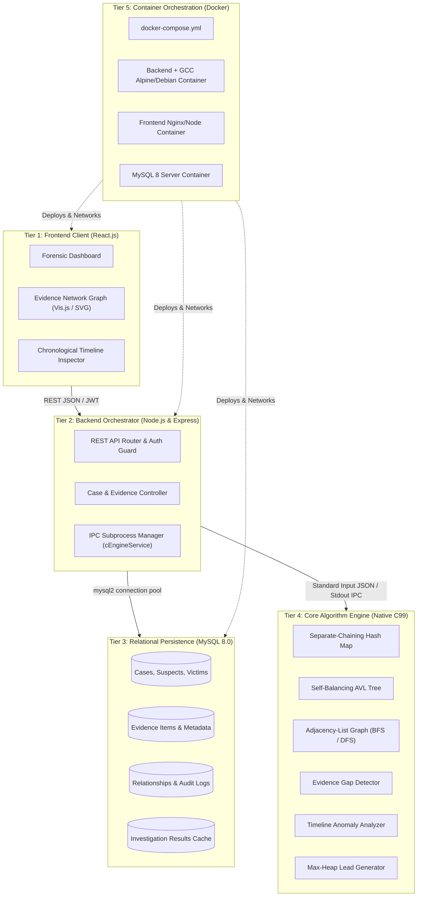
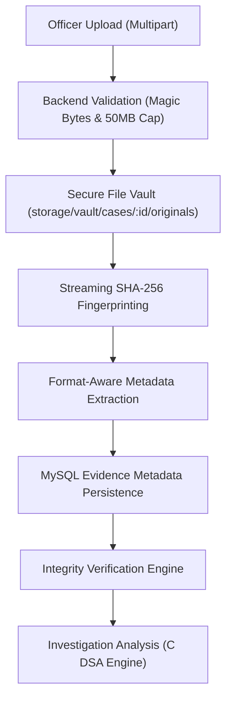
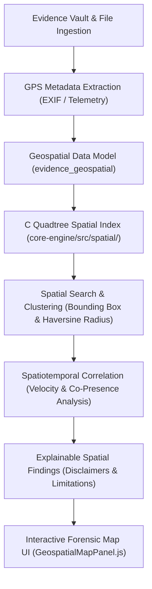

# CASETHREAD

> **"Connecting Evidence. Uncovering the Missing Pieces."**  
> *A professional digital forensic investigation support platform powered by a high-performance C Data Structures & Algorithms (DSA) core engine.*

---

## 1. System Overview

During complex criminal investigations, police authorities and forensic detectives collect massive volumes of heterogeneous, seemingly disconnected data:
- Suspect & victim profiles
- Witness testimonies & credibility indices
- Timestamped CCTV surveillance records
- Cellular tower dumps & call detail records (CDR)
- Vehicle DMV registrations & ANPR sightings
- Physical, digital, and bio-forensic evidence items

Initially, these clues appear isolated. **CASETHREAD** ingests and parses this evidence network into advanced algorithmic structures implemented in native **C**, applying graph theory, self-balancing search trees, hash indices, and priority queues to detect:
1. **Hidden Evidence Relationships:** Multi-hop associative chains connecting suspects, witnesses, and vehicles.
2. **Investigation Gaps & Missing Evidence:** Broken chains of corroboration, surveillance blindspots, and unverified alibi windows.
3. **Timeline Inconsistencies & Anomalies:** Spatiotemporal contradictions (e.g. impossible travel speed between sightings).
4. **Actionable Investigative Leads:** Prioritized next-step recommendations for detectives.

> **Forensic Integrity Notice:** CASETHREAD acts strictly as an investigative decision-support system. It never automatically declares guilt or presents unverified algorithmic hypotheses as established judicial facts.

---

## 2. System Architecture

CASETHREAD is architected across five distinct tiers:



---

## 3. Data Structures & Algorithm (DSA) Specifications

The core algorithm engine is developed in **C** to demonstrate rigorous, manual data structure implementations with predictable time and space bounds:

| Data Structure / Algorithm | Source Location | Forensic Investigation Purpose | Time Complexity | Space Complexity |
| :--- | :--- | :--- | :--- | :--- |
| **Separate-Chaining Hash Map** | `core-engine/src/hashmap/` | $O(1)$ constant-time lookup for entities by tracking code, license plate, phone IMEI, or entity key. | Average: $O(1)$<br>Worst: $O(N)$ | $O(N)$ |
| **Self-Balancing AVL Tree** | `core-engine/src/trees/` | Strict chronological event ledger ordered by epoch timestamp. Supports $O(\log N + K)$ range queries. | Insert/Search: $O(\log N)$<br>Range: $O(\log N + K)$ | $O(N)$ |
| **Adjacency-List Graph** | `core-engine/src/graphs/` | Relational network where vertices are entities/evidence and edges are weighted associations. | Storage: $O(V + E)$<br>Edge Lookup: $O(\text{deg}(V))$ | $O(V + E)$ |
| **Breadth-First Search (BFS)** | `core-engine/src/graphs/` | Computes unweighted shortest associative hops between suspect and victim or scene. | $O(V + E)$ | $O(V)$ |
| **Depth-First Search (DFS)** | `core-engine/src/graphs/` | Discovers connected cliques, isolated evidence clusters, and circular relationship cycles. | $O(V + E)$ | $O(V)$ |
| **Binary Max-Heap / Priority Queue** | `core-engine/src/structures/` | Dynamically resizable binary heap maintaining root maximum lead priority score for investigative recommendation extraction. | Insert/Extract: $O(\log K)$<br>Peek: $O(1)$ | $O(K)$ |
| **2D Quadtree Spatial Index** | `core-engine/src/spatial/` | Hierarchical spatial index for geospatial bounding-box and geodesic Haversine radius queries. | Range: $O(\log N + K)$<br>Build: $O(N \log N)$ | $O(N)$ |

---

## 4. Node.js to C Inter-Process Communication (IPC)

The bridge between the Node.js API orchestrator and the native C algorithm engine utilizes standard POSIX/Win32 I/O streams:

```
[Node.js Backend]                                           [C Engine Executable]
  │                                                                   │
  ├── 1. Gather Case Entities, Timeline & Graph from MySQL            │
  ├── 2. child_process.spawn("casethread_engine", ["--stdin"])        │
  ├── 3. Write structured JSON stream ──────── stdin ────────────────>│
  │                                                                   ├── 4. Ingest JSON buffer
  │                                                                   ├── 5. Populate HashMaps & AVL Tree
  │                                                                   ├── 6. Traverse Graph (BFS/DFS)
  │                                                                   ├── 7. Detect Gaps & Anomalies
  │                                                                   ├── 8. Rank Leads via Max-Heap
  │<─── 9. Read diagnostic logs (non-blocking) ── stderr ─────────────┤
  │<─── 10. Read analysis output JSON ─────────── stdout ─────────────┤
  ├── 11. Parse JSON, validate schemas & persist to MySQL             │
  └── 12. Return HTTP 200 payload to React Frontend                   ▼
```

### IPC Safety & Fault Tolerance
1. **Process Isolation:** The C executable runs in an isolated sub-process; a segmentation fault in C does not terminate the Node.js server.
2. **Watchdog Timer:** The Node process enforces a strict timeout (`C_ENGINE_TIMEOUT_MS = 8000ms`). Any stalled process is terminated via `SIGKILL`.
3. **Stream Separation:** Diagnostics, memory usage, and assertions route exclusively to `stderr`, guaranteeing that `stdout` contains valid, unpolluted JSON.

---

## 5. Directory Structure & Module Responsibilities

```
CASETHREAD/
├── frontend/                       # React.js Forensic Dashboard Client
│   ├── public/                     # Static assets, HTML shell, favicon, manifests
│   └── src/
│       ├── assets/                 # Icons, badges, forensic diagrams
│       ├── components/             # Reusable forensic UI widgets (Navbar, GraphViewer, Cards)
│       ├── pages/                  # Page controllers (Dashboard, CaseDetail, Login)
│       ├── services/               # REST API client and token managers
│       └── styles/                 # Theme tokens: Charcoal, Crimson, Amber typography
│
├── backend/                        # Node.js Express REST Backend Orchestrator
│   ├── controllers/                # Business logic handlers (auth, case, evidence, analysis)
│   ├── database/                   # MySQL connection pool configuration
│   ├── middleware/                 # JWT authentication guard and centralized error handling
│   ├── routes/                     # REST API route manifests
│   ├── services/                   # IPC integration service for C engine execution
│   └── server.js                   # Application bootstrap & HTTP server entrypoint
│
├── core-engine/                    # Native C Data Structures & Algorithms Subsystem
│   ├── include/                    # C header files (.h) defining structs and interfaces
│   │   ├── algorithms.h            # Gap detection, timeline analysis & lead ranking headers
│   │   ├── common.h                # System enums, error codes, and memory allocators
│   │   ├── graph.h                 # Adjacency list graph & traversal declarations
│   │   ├── hashmap.h               # Separate-chaining hashmap interface
│   │   └── tree.h                  # Self-balancing AVL tree interface
│   ├── src/                        # C source implementations (.c)
│   │   ├── algorithms/             # Gap, timeline anomaly, and heuristic lead engines
│   │   ├── graphs/                 # Graph construction, BFS, DFS, cycle detection
│   │   ├── hashmap/                # Hash map hashing functions and bucket handlers
│   │   ├── trees/                  # AVL rotation, balance, and range query routines
│   │   └── main.c                  # CLI entrypoint and standard I/O IPC driver
│   ├── tests/                      # Unit test suites for individual DSA components
│   └── Makefile                    # Cross-platform compilation targets (GCC / Clang / MinGW)
│
├── database/                       # Relational Database Schemas & Migrations
│   └── schema.sql                  # MySQL 8.0 schema: 10 tables, constraints, seed dataset
│
├── docker/                         # Docker container definitions
│   ├── Dockerfile.backend          # Node.js + GCC toolchain environment
│   └── Dockerfile.frontend         # React production build server
│
├── .gitignore                      # Stack-tailored exclusion manifest
├── .env.example                    # Environment variable configuration template
├── docker-compose.yml              # Complete multi-container orchestration definition
├── README.md                       # Master architecture documentation
└── DEVELOPMENT_ROADMAP.md          # Phased execution plan and milestone criteria
```

---

## 6. MySQL Database Schema

The relational database is normalized and indexed for high-concurrency investigative access:

1. `officers` – Authenticated detective identities, roles, departments, and badge IDs.
2. `cases` – Master investigation records, priority levels, statuses, and lead officers.
3. `suspects` – Profiles of interest, aliases, identifying markers, and judicial statuses.
4. `victims` – Case victims, condition statuses, and witness connections.
5. `witnesses` – Witness testimonies, interview timestamps, and credibility scores ($0.00 - 1.00$).
6. `evidence_items` – Physical, digital, phone, CCTV, and vehicle evidence records.
7. `evidence_relationships` – Explicit relational links (graph edges) with confidence ratings.
8. `timeline_events` – Chronological event log indexed for tree-based anomaly detection.
9. `investigation_results` – Persisted C-engine algorithmic run outputs and discovered gaps.
10. `audit_logs` – Immutable chain-of-custody and action log for forensic compliance.

---

## 7. Security & Production Hardening

CASETHREAD incorporates enterprise-grade production safety standards:

1. **Strict Production Database Enforcement (Zero-Fallback Policy):**
   - MemoryStore is **strictly restricted** to unit tests (`NODE_ENV === 'test'`) and explicitly flagged local testing (`ALLOW_MEMORY_STORE === 'true'`).
   - In production (`NODE_ENV === 'production'`), fallback to in-memory state is completely eliminated.
   - If MySQL is unreachable, crashes, or drops connections, the application terminates or reports `UNHEALTHY` (HTTP 503) rather than silently losing investigative data.
   - Transactions (`withTransaction`) fail fast on connection loss and never masquerade as successful.
2. **Runtime Configuration Validation (`validateConfig`):**
   - Backend startup performs strict validation of cryptographic and operational secrets.
   - Requires `JWT_SECRET` $\ge 32$ characters, rejecting default/insecure keys (`"secret"`, `"password"`, etc.).
   - Rejects wildcard CORS (`*`) in production; requires explicit `CLIENT_ORIGIN` whitelisting.
   - Blocks demo credentials (`ENABLE_DEMO_CREDENTIALS`) and in-memory stores in production.
3. **Environment-Driven Orchestration:**
   - Secrets and passwords are completely removed from `docker-compose.yml` and injected via `.env`.
   - Backend Docker service waits on MySQL readiness via `condition: service_healthy` before initializing.
4. **Resilient Health Diagnostics:**
   - `/api/v1/health` probes the live database connection and reflects true database health (`status: 'HEALTHY'` vs `'UNHEALTHY'`).

---

## 8. Empirical C DSA Benchmarks

The core C engine contains an empirical benchmarking suite (`core-engine/tests/benchmark_dsa.c`) measuring throughput and latency across $N \in [100, 10000]$ operations:

| Component | Operation | Scale ($N$) | Total Time ($\mu$s) | Mean Latency | Throughput (ops/sec) | Complexity |
| :--- | :--- | :--- | :--- | :--- | :--- | :--- |
| **Separate-Chaining Hash Map** | Sequential Insert | 10,000 | 2,752 $\mu$s | 0.28 $\mu$s | 3.63 M ops/s | $O(1)$ avg |
| **Separate-Chaining Hash Map** | Exact Lookup | 10,000 | 1,550 $\mu$s | 0.16 $\mu$s | 6.45 M ops/s | $O(1)$ avg |
| **Self-Balancing AVL Tree** | Chronological Insert | 10,000 | 3,115 $\mu$s | 0.31 $\mu$s | 3.21 M ops/s | $O(\log N)$ |
| **Self-Balancing AVL Tree** | Timestamp Search | 10,000 | 172 $\mu$s | 0.02 $\mu$s | 58.07 M ops/s | $O(\log N)$ |
| **Self-Balancing AVL Tree** | Range Query (25%) | 10,000 | 104 $\mu$s | 104 $\mu$s | 9.61 K queries/s | $O(\log N + K)$ |
| **Binary Max-Heap** | Priority Insert | 10,000 | 1,180 $\mu$s | 0.12 $\mu$s | 8.47 M ops/s | $O(\log N)$ |
| **Binary Max-Heap** | Root Peek Max | 10,000 | 23 $\mu$s | 0.002 $\mu$s | 442.48 M ops/s | $O(1)$ |
| **Binary Max-Heap** | Extract Max (Heapify) | 10,000 | 1,908 $\mu$s | 0.19 $\mu$s | 5.24 M ops/s | $O(\log N)$ |
| **Adjacency-List Graph** | BFS Shortest Path | 1,000 $V$ | 24 $\mu$s | 24 $\mu$s | 41.67 K queries/s | $O(V + E)$ |
| **Adjacency-List Graph** | DFS Connected Cliques | 1,000 $V$ | 77 $\mu$s | 77 $\mu$s | 12.99 K traversals/s | $O(V + E)$ |

Full benchmark data and asymptotic scaling curves are available in [`core-engine/benchmarks/README.md`](file:///core-engine/benchmarks/README.md).

---

## 9. Setup & Execution Guide

### Option A: Complete System via Docker Compose (Recommended)

Docker Compose coordinates MySQL 8.0, the native C compiler toolchain, the Node.js orchestrator, and the React client:

```bash
# 1. Clone repository
git clone https://github.com/Saravana65/CaseThread.git
cd CaseThread

# 2. Configure production secrets
cp .env.example .env
# Edit .env and supply secure MYSQL_ROOT_PASSWORD, DB_PASSWORD, and JWT_SECRET (>= 32 chars)

# 3. Validate configuration
docker-compose config

# 4. Launch all services
docker-compose up --build -d
```
- **Frontend Dashboard:** [http://localhost:3000](http://localhost:3000)
- **Backend API:** [http://localhost:5000/api/v1/health](http://localhost:5000/api/v1/health)
- **MySQL Server:** Port `3306` (`casethread_db`)

---

### Option B: Local Development Execution

#### 1. Database Initialization
Import the schema into a running MySQL 8.0 instance:
```bash
mysql -u root -p < database/schema.sql
```

#### 2. C Core Engine Compilation & Benchmarking
Compile the native algorithm engine using GCC or MSVC:
```bash
cd core-engine

# Build binary and unit tests
build.bat            # Windows MSVC
# or: make all test  # Linux / GCC

# Run C engine unit tests (91 assertions across 7 modules)
bin/test_dsa.exe     # or: ./bin/test_dsa

# Run empirical DSA benchmark suite
bin/benchmark_dsa.exe # or: ./bin/benchmark_dsa
cd ..
```

#### 3. Backend Setup
```bash
cd backend
cp ../.env.example .env
# Ensure JWT_SECRET is set to at least 32 characters
npm install
npm run dev
```

#### 4. Frontend Setup
```bash
cd frontend
npm install
npm start
```

---

## 10. Verification & Test Suite Summary

Execute the full automated quality assurance matrix across all system tiers:

```bash
# 1. Core C Engine Unit Tests & Spatial Index (118 assertions)
cd core-engine
build.bat && bin/test_dsa.exe && bin/test_quadtree.exe

# 2. Empirical C Benchmark Suite (DSA & Quadtree)
bin/benchmark_dsa.exe
bin/benchmark_quadtree.exe

# 3. Backend Test Matrix (122 tests across 15 suites)
cd ../backend
node --test tests/production_safety.test.js \
            tests/frontend_workflow.test.js \
            tests/integration.test.js \
            tests/graph.test.js \
            tests/e2e.test.js \
            tests/forensic_integrity.test.js \
            tests/evidence_vault.test.js \
            tests/geospatial.test.js

# 4. Frontend Production Build Verification
cd ../frontend
npm test -- --watchAll=false
npm run build
```

---

## 11. Forensic Integrity & Explainable Intelligence (Phase 7)

Phase 7 upgrades CASETHREAD into a forensic decision-support platform with cryptographic verification, auditable chain-of-custody, backward-linked audit hash chaining, and explainable algorithmic findings.

### Cryptographic Fingerprinting & Integrity Verification
Every evidence item is cryptographically sealed with a SHA-256 hash upon ingestion:
- **Raw Content Fingerprinting (`CONTENT_SHA256`):** Computed directly over ingested binary or text payload bytes (e.g. surveillance video frames, phone call transcripts).
- **Metadata Snapshot Fingerprinting (`METADATA_CANONICAL`):** Computed over a deterministic, sorted, canonical JSON representation of tracking code, category, title, description, and source when raw binary content is absent.
- **Integrity Status States:**
  - `INTACT`: Payload matches the original recorded fingerprint with zero bit-level discrepancies.
  - `TAMPERED_MISMATCH`: Live payload or canonical metadata diverges from the recorded fingerprint. An alert is instantly triggered in the dashboard.
  - `PENDING`: Newly ingested evidence awaiting formal forensic verification by the case lead officer.

### Tamper-Evident Audit Hash Chaining
Audit logs in `evidence_audit_logs` are linked backward in a cryptographic hash chain:
$$\text{Event Hash}_i = \text{SHA-256}\left(\text{Event Hash}_{i-1} \parallel \text{Officer ID} \parallel \text{Action} \parallel \text{Canonical Payload} \parallel \text{Timestamp}\right)$$
- Initial events link directly to the system constant `GENESIS_HASH` (`0000000000000000000000000000000000000000000000000000000000000000`).
- The verification utility (`cryptoService.verifyAuditChain`) recalculates every hash in sequence:
  - If a database administrator or malicious actor alters an event payload, `verifyAuditChain` fails with `PAYLOAD_TAMPERING_DETECTED`.
  - If records are deleted or chronological sequence is altered, verification fails with `LINKAGE_INTEGRITY_VIOLATION`.

### Chain-of-Custody Workflow
Custody transfers are tracked in `evidence_custody_events` with complete provenance:
- Transferring officer ID and receiving officer ID.
- Mandatory transfer purpose (`TRANSFERRED_FOR_ANALYSIS`, `CHECKED_OUT_FOR_COURT`, `RETURNED_TO_SECURE_STORAGE`).
- Destination location (e.g., "Forensic Crime Lab - Ballistics Unit").
- Case isolation: Cross-case custody transfers by non-assigned officers are strictly rejected with HTTP 403 Forbidden.

### Structured Case Dossier Export & Printable Reports
- **JSON Export (`GET /api/v1/reports/cases/:caseId/json`):** Complete structured export including case summary, suspects, victims, witnesses, evidence inventory with fingerprints, custody events, relational network, chronological timeline, algorithm leads with formula breakdown, and audit verification status.
- **Printable HTML/PDF Dossier (`GET /api/v1/reports/cases/:caseId/html`):** Formatted for law enforcement presentation with official classification banners, print pagination controls, and forensic audit seals. Zero credentials or sensitive hashes are leaked.

### Academic Scope & Judicial Disclaimer
> **IMPORTANT ADMISSIBILITY NOTICE:** CASETHREAD is designed as an academic decision-support framework to demonstrate cryptographic provenance and advanced data structures. It provides mathematical and cryptographic guarantees of internal database consistency. However, it does **NOT** constitute a certified statutory forensic acquisition tool or substitute for court-recognized legal chain-of-custody documentation without independent sworn verification.

---

## 12. Digital Evidence Acquisition, Secure File Vault & Multi-Format Ingestion (Phase 8)

Phase 8 connects actual digital evidence files (documents, images, audio, video, structured records) to the cryptographic provenance and C DSA intelligence workflows established in previous phases.

### Ingestion & Verification Architecture Flowchart



### Supported Evidence Formats & Magic Byte Signatures

Client-supplied file extensions and MIME headers are never trusted. All incoming files undergo binary signature (magic byte) verification before storage:

| Format Category | Supported Extensions | Detected MIME Type | Binary Magic Byte Signature / Validation |
| :--- | :--- | :--- | :--- |
| **Documents** | `.pdf` | `application/pdf` | Header matches `%PDF-` (`0x25 0x50 0x44 0x46`) |
| **Images** | `.png`, `.jpg`, `.jpeg` | `image/png`, `image/jpeg` | PNG: `0x89 0x50 0x4E 0x47 0x0D 0x0A 0x1A 0x0A`<br>JPEG: `0xFF 0xD8 0xFF` SOI marker |
| **Audio** | `.wav`, `.mp3` | `audio/wav`, `audio/mpeg` | WAV: `RIFF....WAVE`<br>MP3: `ID3` tag or MPEG frame sync (`0xFF 0xFB/F3/F2`) |
| **Video** | `.mp4` | `video/mp4` | ISO Base Media File Format box atom `ftyp` at offset 4 |
| **Structured Data** | `.csv`, `.json`, `.xml`, `.txt` | `text/csv`, `application/json`, `application/xml`, `text/plain` | Non-binary UTF-8 text validation and syntax parsing (JSON, XML tag delimiters `<...?`) |

### Secure File Vault & Storage Layout

Physical evidence files are stored strictly outside the public web root in an isolated hierarchical directory tree:

```
storage/vault/
└── cases/
    └── <case_id>/
        ├── originals/   # Read-only original forensic evidence files (<uuid>_<filename>)
        └── artifacts/   # Derived non-destructive research artifacts (<uuid>_<filename>)
```

- **Docker Volume Mount:** Backed by the named volume `evidence_vault:/app/storage/vault`, ensuring persistence across container upgrades and redeployments.
- **Path Traversal Defense:** Sanitizes filenames, prohibits null bytes, absolute paths, and parent directory traversal (`..`).
- **Streaming Transfer & Access Control:** Files are streamed via authenticated endpoints with HTTP byte-range capability. Cross-case downloads by non-assigned officers are rejected with HTTP 403 Forbidden.

### Format-Aware Metadata Extraction

The ingestion pipeline automatically and non-destructively extracts format-specific technical parameters stored in `evidence_metadata_extractions`:
- **Images:** Dimensions (width/height), color depth, camera manufacturer/model, ISO, exposure time, aperture, focal length, capture timestamp, and GPS coordinates (latitude/longitude/altitude).
- **Documents:** Page count, PDF title, author, producer, creation/modification dates, and format version.
- **Audio:** Duration in seconds, audio format/codec, sample rate (Hz), channel count (mono/stereo), and bit rate.
- **Video:** Frame dimensions, duration, time scale, and video/audio codec four-character tags (e.g. `avc1`, `mp4a`).
- **Data & Text:** Character encoding, total record/line count, header column names, column counts, and top-level JSON keys.

### Derived Forensic Artifacts & Lineage

Detectives can generate derived research artifacts without modifying the original immutable evidence:
- **`EXTRACTED_TEXT`:** Text stream extracted from PDF, OCR, or transcription sources.
- **`NORMALIZED_DATA`:** Converted structured tabular data (e.g., CSV rows transformed to canonical JSON).
- **`PREVIEW_IMAGE`:** Rescaled thumbnails or preview frames for quick officer inspection.

Every derived artifact is independently hashed with its own SHA-256 fingerprint, linked to its parent file via `parent_file_id` in `evidence_derived_artifacts`, preserving complete chain-of-custody lineage.

### Vault API Endpoints Reference

| Method | Endpoint | Description |
| :--- | :--- | :--- |
| `POST` | `/api/v1/vault/cases/:caseId/upload` | Multipart evidence file upload with magic byte verification and automated metadata extraction. |
| `GET` | `/api/v1/vault/cases/:caseId/files` | Retrieve inventory of all vault files uploaded for a specific case. |
| `GET` | `/api/v1/vault/files/:fileId` | Detailed technical file inspection, metadata extraction, and derived artifacts. |
| `GET` | `/api/v1/vault/files/:fileId/download` | Secure byte-stream download of original forensic file (assigned officers only). |
| `GET` | `/api/v1/vault/files/:fileId/preview` | In-line preview rendering with range requests for images, PDFs, audio, and video. |
| `POST` | `/api/v1/vault/files/:fileId/verify-integrity` | On-demand bit-level verification comparing live disk bytes with recorded SHA-256 fingerprint. |
| `POST` | `/api/v1/vault/files/:fileId/artifacts` | Generate derived forensic artifact (`EXTRACTED_TEXT`, `NORMALIZED_DATA`, `PREVIEW_IMAGE`). |
| `GET` | `/api/v1/vault/artifacts/:artifactId/download` | Download derived artifact file. |
| `POST` | `/api/v1/vault/extractions/:extractionId/review` | Officer review and confirmation of extracted metadata attributes. |
| `GET` | `/api/v1/vault/cases/:caseId/search` | Search and filter vault files by query, format, category, officer, or integrity status. |

---

## 13. Geospatial Evidence Intelligence & Interactive Mapping (Phase 9)

Phase 9 equips CASETHREAD with spatial indexing and spatiotemporal investigation capabilities, connecting physical and digital evidence coordinates to an interactive forensic mapping workspace.

### Geospatial Investigation Architecture



### C Quadtree Spatial Indexing & Geodesic Equations

To achieve sub-millisecond spatial query performance across large investigations, CASETHREAD implements a native 2D hierarchical Quadtree (`core-engine/src/spatial/quadtree.c`) with configurable bucket capacity (default 8) and dynamic subdivision up to depth 24.

- **Bounding Box Query:** Hierarchically intersects query regions against quadrant boundaries in $O(\log N + K)$ average time.
- **Geodesic Haversine Distance:** Bounding box candidate pruning is followed by exact great-circle distance evaluation ($R = 6,371,008.8\text{ meters}$):
  $$\Delta\phi = \frac{(\phi_2 - \phi_1) \cdot \pi}{180}, \quad \Delta\lambda = \frac{(\lambda_2 - \lambda_1) \cdot \pi}{180}$$
  $$a = \sin^2\left(\frac{\Delta\phi}{2}\right) + \cos\left(\frac{\phi_1 \cdot \pi}{180}\right) \cos\left(\frac{\phi_2 \cdot \pi}{180}\right) \sin^2\left(\frac{\Delta\lambda}{2}\right)$$
  $$d = 2 \cdot R \cdot \text{atan2}\left(\sqrt{a}, \sqrt{1 - a}\right)$$
- **Antimeridian & Polar Handling:** Queries straddling the $+180^\circ / -180^\circ$ meridian split into disjoint sub-boxes ($[\text{min\_lon}, 180^\circ]$ and $[-180^\circ, \text{max\_lon}]$). Polar latitudes are clamped to $[-90^\circ, 90^\circ]$ with full longitude span.
- **Duplicate Coordinates:** Identical coordinates are chained via `next_duplicate` linked lists, avoiding infinite subdivision.

### Empirical Quadtree Performance vs Linear Scan

Empirical benchmark execution conducted via `core-engine/bin/benchmark_quadtree.exe` across scales up to $N = 10,000$ points (`benchmarks/quadtree_benchmark_results.csv`):

| Points ($N$) | Quadtree Radius Query ($\mu$s) | Linear Scan Radius ($\mu$s) | Query Parity | Empirical Quadtree Speedup |
| :--- | :--- | :--- | :--- | :--- |
| **100** | 11.91 $\mu$s | 8.15 $\mu$s | 100% Match | $0.68\times$ (overhead threshold) |
| **500** | 2.55 $\mu$s | 38.84 $\mu$s | 100% Match | **$15.24\times$ Speedup** |
| **1,000** | 5.66 $\mu$s | 79.00 $\mu$s | 100% Match | **$13.95\times$ Speedup** |
| **5,000** | 46.74 $\mu$s | 503.25 $\mu$s | 100% Match | **$10.77\times$ Speedup** |
| **10,000** | 90.99 $\mu$s | 1,607.29 $\mu$s | 100% Match | **$17.67\times$ Speedup** |

### Geospatial Investigation Algorithms

1. **Geographical Proximity Search:**
   - Evaluates evidence within radius $R$ of a crime scene or coordinates. Supports conversion to kilometers, miles, and feet.
2. **Spatial Density Clustering:**
   - Connected-component density algorithm discovering clusters within configurable distance thresholds (e.g. 200m). Computes cluster centroids, spread radii, and flags isolated outlier evidence items.
3. **Shared Location Detection:**
   - Detects observations situated at identical or near-identical coordinates ($\le 25\text{m}$).
4. **Spatiotemporal Travel Velocity Analysis:**
   - Evaluates minimum transit velocity between consecutive observations:
     $$v = \frac{d}{\Delta t} \times 3.6\text{ (km/h)}$$
   - Transitions exceeding 180 km/h are flagged as `SPATIOTEMPORAL_SPEED_ANOMALY`.
5. **Spatial-Temporal Co-Presence:**
   - Detects distinct entities observed within 100m and 15 minutes of each other.

### Map Privacy, Security & Judicial Disclaimers

- **Zero External Geocoding:** Sensitive crime scene coordinates are processed strictly on the local backend and client. No coordinate payloads are transmitted to external geocoding or AI APIs.
- **Configurable Basemap:** Defaults to an air-gapped Tactical Grid mode with zero external network requests, with optional CartoDB Dark Matter / OSM basemap overlays.
- **Strict Evidence Admissibility Notice:**
  > **IMPORTANT NOTICE:** Spatial proximity or shared location does **NOT** prove direct physical contact, mutual awareness, or criminal association. GPS coordinates extracted from media do not prove that photographed criminal activity occurred at that specific location. All spatial findings serve strictly as investigative decision-support hypotheses.

### Geospatial API Endpoints Reference

| Method | Endpoint | Description |
| :--- | :--- | :--- |
| `GET` | `/api/v1/cases/:caseId/geospatial` | Retrieve all cataloged geospatial points for a case with joined evidence metadata. |
| `POST` | `/api/v1/cases/:caseId/geospatial/search` | Execute bounding box or Haversine radius queries with category and source filters. |
| `GET` | `/api/v1/cases/:caseId/geospatial/clusters` | Discover spatial density clusters and isolated evidence items. |
| `POST` | `/api/v1/cases/:caseId/geospatial/analyze` | Execute spatiotemporal velocity anomaly and co-presence correlation analysis. |
| `POST` | `/api/v1/cases/:caseId/geospatial/points` | Manually record or associate coordinates with an evidence record. |
| `GET` | `/api/v1/evidence/:evidenceId/location` | Retrieve coordinate history and EXIF extractions for a specific evidence item. |
| `POST` | `/api/v1/cases/:caseId/geospatial/points/:id/review` | Officer review and sign-off on recorded geospatial coordinates. |
