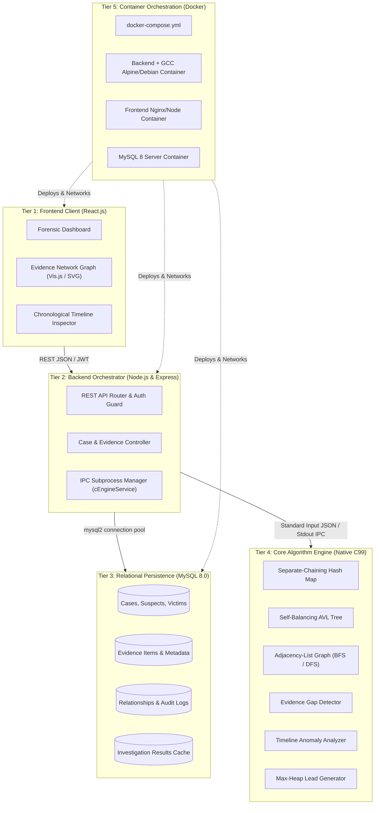

# CASETHREAD

> **"Connecting Evidence. Uncovering the Missing Pieces."**  
> *A professional digital forensic investigation support platform powered by a high-performance C Data Structures & Algorithms (DSA) core engine.*

---

## 1. System Overview

During complex criminal investigations, police authorities and forensic detectives collect massive volumes of heterogeneous, seemingly disconnected data:
- Suspect & victim profiles
- Witness testimonies & credibility indices
- Timestamped CCTV surveillance records
- Cellular tower dumps & call detail records (CDR)
- Vehicle DMV registrations & ANPR sightings
- Physical, digital, and bio-forensic evidence items

Initially, these clues appear isolated. **CASETHREAD** ingests and parses this evidence network into advanced algorithmic structures implemented in native **C**, applying graph theory, self-balancing search trees, hash indices, and priority queues to detect:
1. **Hidden Evidence Relationships:** Multi-hop associative chains connecting suspects, witnesses, and vehicles.
2. **Investigation Gaps & Missing Evidence:** Broken chains of corroboration, surveillance blindspots, and unverified alibi windows.
3. **Timeline Inconsistencies & Anomalies:** Spatiotemporal contradictions (e.g. impossible travel speed between sightings).
4. **Actionable Investigative Leads:** Prioritized next-step recommendations for detectives.

> **Forensic Integrity Notice:** CASETHREAD acts strictly as an investigative decision-support system. It never automatically declares guilt or presents unverified algorithmic hypotheses as established judicial facts.

---

## 2. System Architecture

CASETHREAD is architected across five distinct tiers:



---

## 3. Data Structures & Algorithm (DSA) Specifications

The core algorithm engine is developed in **C** to demonstrate rigorous, manual data structure implementations with predictable time and space bounds:

| Data Structure / Algorithm | Source Location | Forensic Investigation Purpose | Time Complexity | Space Complexity |
| :--- | :--- | :--- | :--- | :--- |
| **Separate-Chaining Hash Map** | `core-engine/src/hashmap/` | $O(1)$ constant-time lookup for entities by tracking code, license plate, phone IMEI, or entity key. | Average: $O(1)$<br>Worst: $O(N)$ | $O(N)$ |
| **Self-Balancing AVL Tree** | `core-engine/src/trees/` | Strict chronological event ledger ordered by epoch timestamp. Supports $O(\log N + K)$ range queries. | Insert/Search: $O(\log N)$<br>Range: $O(\log N + K)$ | $O(N)$ |
| **Adjacency-List Graph** | `core-engine/src/graphs/` | Relational network where vertices are entities/evidence and edges are weighted associations. | Storage: $O(V + E)$<br>Edge Lookup: $O(\text{deg}(V))$ | $O(V + E)$ |
| **Breadth-First Search (BFS)** | `core-engine/src/graphs/` | Computes unweighted shortest associative hops between suspect and victim or scene. | $O(V + E)$ | $O(V)$ |
| **Depth-First Search (DFS)** | `core-engine/src/graphs/` | Discovers connected cliques, isolated evidence clusters, and circular relationship cycles. | $O(V + E)$ | $O(V)$ |
| **Max-Heap / Priority Queue** | `core-engine/src/algorithms/` | Ranks generated investigative leads by algorithmic priority score based on weight and centrality. | Insert/Extract: $O(\log K)$<br>Peek: $O(1)$ | $O(K)$ |

---

## 4. Node.js to C Inter-Process Communication (IPC)

The bridge between the Node.js API orchestrator and the native C algorithm engine utilizes standard POSIX/Win32 I/O streams:

```
[Node.js Backend]                                           [C Engine Executable]
  │                                                                   │
  ├── 1. Gather Case Entities, Timeline & Graph from MySQL            │
  ├── 2. child_process.spawn("casethread_engine", ["--stdin"])        │
  ├── 3. Write structured JSON stream ──────── stdin ────────────────>│
  │                                                                   ├── 4. Ingest JSON buffer
  │                                                                   ├── 5. Populate HashMaps & AVL Tree
  │                                                                   ├── 6. Traverse Graph (BFS/DFS)
  │                                                                   ├── 7. Detect Gaps & Anomalies
  │                                                                   ├── 8. Rank Leads via Max-Heap
  │<─── 9. Read diagnostic logs (non-blocking) ── stderr ─────────────┤
  │<─── 10. Read analysis output JSON ─────────── stdout ─────────────┤
  ├── 11. Parse JSON, validate schemas & persist to MySQL             │
  └── 12. Return HTTP 200 payload to React Frontend                   ▼
```

### IPC Safety & Fault Tolerance
1. **Process Isolation:** The C executable runs in an isolated sub-process; a segmentation fault in C does not terminate the Node.js server.
2. **Watchdog Timer:** The Node process enforces a strict timeout (`C_ENGINE_TIMEOUT_MS = 8000ms`). Any stalled process is terminated via `SIGKILL`.
3. **Stream Separation:** Diagnostics, memory usage, and assertions route exclusively to `stderr`, guaranteeing that `stdout` contains valid, unpolluted JSON.

---

## 5. Directory Structure & Module Responsibilities

```
CASETHREAD/
├── frontend/                       # React.js Forensic Dashboard Client
│   ├── public/                     # Static assets, HTML shell, favicon, manifests
│   └── src/
│       ├── assets/                 # Icons, badges, forensic diagrams
│       ├── components/             # Reusable forensic UI widgets (Navbar, GraphViewer, Cards)
│       ├── pages/                  # Page controllers (Dashboard, CaseDetail, Login)
│       ├── services/               # REST API client and token managers
│       └── styles/                 # Theme tokens: Charcoal, Crimson, Amber typography
│
├── backend/                        # Node.js Express REST Backend Orchestrator
│   ├── controllers/                # Business logic handlers (auth, case, evidence, analysis)
│   ├── database/                   # MySQL connection pool configuration
│   ├── middleware/                 # JWT authentication guard and centralized error handling
│   ├── routes/                     # REST API route manifests
│   ├── services/                   # IPC integration service for C engine execution
│   └── server.js                   # Application bootstrap & HTTP server entrypoint
│
├── core-engine/                    # Native C Data Structures & Algorithms Subsystem
│   ├── include/                    # C header files (.h) defining structs and interfaces
│   │   ├── algorithms.h            # Gap detection, timeline analysis & lead ranking headers
│   │   ├── common.h                # System enums, error codes, and memory allocators
│   │   ├── graph.h                 # Adjacency list graph & traversal declarations
│   │   ├── hashmap.h               # Separate-chaining hashmap interface
│   │   └── tree.h                  # Self-balancing AVL tree interface
│   ├── src/                        # C source implementations (.c)
│   │   ├── algorithms/             # Gap, timeline anomaly, and heuristic lead engines
│   │   ├── graphs/                 # Graph construction, BFS, DFS, cycle detection
│   │   ├── hashmap/                # Hash map hashing functions and bucket handlers
│   │   ├── trees/                  # AVL rotation, balance, and range query routines
│   │   └── main.c                  # CLI entrypoint and standard I/O IPC driver
│   ├── tests/                      # Unit test suites for individual DSA components
│   └── Makefile                    # Cross-platform compilation targets (GCC / Clang / MinGW)
│
├── database/                       # Relational Database Schemas & Migrations
│   └── schema.sql                  # MySQL 8.0 schema: 10 tables, constraints, seed dataset
│
├── docker/                         # Docker container definitions
│   ├── Dockerfile.backend          # Node.js + GCC toolchain environment
│   └── Dockerfile.frontend         # React production build server
│
├── .gitignore                      # Stack-tailored exclusion manifest
├── .env.example                    # Environment variable configuration template
├── docker-compose.yml              # Complete multi-container orchestration definition
├── README.md                       # Master architecture documentation
└── DEVELOPMENT_ROADMAP.md          # Phased execution plan and milestone criteria
```

---

## 6. MySQL Database Schema

The relational database is normalized and indexed for high-concurrency investigative access:

1. `officers` – Authenticated detective identities, roles, departments, and badge IDs.
2. `cases` – Master investigation records, priority levels, statuses, and lead officers.
3. `suspects` – Profiles of interest, aliases, identifying markers, and judicial statuses.
4. `victims` – Case victims, condition statuses, and witness connections.
5. `witnesses` – Witness testimonies, interview timestamps, and credibility scores ($0.00 - 1.00$).
6. `evidence_items` – Physical, digital, phone, CCTV, and vehicle evidence records.
7. `evidence_relationships` – Explicit relational links (graph edges) with confidence ratings.
8. `timeline_events` – Chronological event log indexed for tree-based anomaly detection.
9. `investigation_results` – Persisted C-engine algorithmic run outputs and discovered gaps.
10. `audit_logs` – Immutable chain-of-custody and action log for forensic compliance.

---

## 7. Setup & Execution Guide

### Option A: Complete System via Docker Compose (Recommended)

Docker Compose builds the C compiler toolchain, backend, frontend, and MySQL database automatically:

```bash
# 1. Clone the repository
git clone https://github.com/Saravana65/CaseThread.git
cd CaseThread

# 2. Launch all services
docker-compose up --build
```
- **Frontend Dashboard:** [http://localhost:3000](http://localhost:3000)
- **Backend API:** [http://localhost:5000/api/v1/health](http://localhost:5000/api/v1/health)
- **MySQL Server:** Port `3306` (`casethread_db`)

---

### Option B: Local Development Execution

#### 1. Database Initialization
Import the schema into a running MySQL 8.0 instance:
```bash
mysql -u root -p < database/schema.sql
```

#### 2. C Core Engine Compilation
Compile the native algorithm engine using GCC or Clang:
```bash
cd core-engine
make clean && make all
# Verify the compiled binary
./bin/casethread_engine --version
cd ..
```

#### 3. Backend Setup
```bash
cd backend
cp ../.env.example .env
npm install
npm run dev
```

#### 4. Frontend Setup
```bash
cd frontend
npm install
npm start
```
