# CASETHREAD — PROJECT OVERVIEW
## Evidence Gap Detection & Investigation Support System

**Academic Project Evaluation & Viva Guide**  
**Repository:** [https://github.com/Saravana65/CaseThread.git](https://github.com/Saravana65/CaseThread.git)  
**Classification:** Advanced Data Structures & Algorithms (ADS) Project-Based Learning (PBL)  

---

## 1. Problem Statement

In modern criminal and cyber-forensic investigations, evidence originates from a multitude of disconnected sources:
- Physical items (fingerprints, weapons, recovered mechanical keys)
- Digital telemetry (Wi-Fi RADIUS logs, IP traffic, device connections)
- Sensory and surveillance recordings (CCTV footage, motion triggers)
- Human testimonial statements (witness accounts, suspect alibis, victim depositions)

Detectives face three foundational challenges:
1. **Evidentiary Fragmentation & Gaps:** Investigators often fail to notice missing relationships between evidence items—such as an uncorroborated alibi window or an isolated piece of physical evidence with no recorded chain-of-custody transfer.
2. **Computational Scale & Relational Topology:** Relational databases struggle with multi-hop association queries (e.g., finding the shortest path of contact between a suspect and a crime scene across 5 intermediary evidence links).
3. **Forensic Integrity & Auditability:** Digital evidence requires cryptographic proof (SHA-256 digests) and tamper-evident custody chains to be legally admissible.

---

## 2. Motivation

Most academic computer science projects simulate algorithms using static animations or synthetic arrays. **CaseThread** was built to demonstrate **real, production-grade Data Structures and Algorithms** executing in **native compiled C** to solve a genuine investigative domain problem:
- Transforming physical and digital clues into an **in-memory Adjacency List Graph**.
- Executing **Breadth-First Search (BFS)** and **Depth-First Search (DFS)** to trace accomplice networks and circular transactions.
- Running **Connected Component Partitioning** to mechanically highlight isolated evidence (potential evidence gaps).
- Utilizing **Self-Balancing AVL Trees** for sub-millisecond chronological event lookups and velocity contradictions.
- Enforcing **Binary Max-Heaps** to ensure limited detective personnel are dispatched to the highest-priority investigative leads first.

---

## 3. Objectives

- **High-Performance Native C Engine:** Compile and execute fundamental data structures (Graphs, HashMaps, AVL Trees, Max-Heaps, Tries) in C99, communicating with the application backend via low-overhead standard I/O (IPC).
- **Relational Evidence Modeling:** Represent persons, vehicles, physical objects, and digital records as vertices, and verified or inferred connections as directed edges with confidence weights.
- **Explainable Evidence-Gap Detection:** Distinguish recorded facts from derived relationships and identify isolated evidence components that require further corroboration without making unfounded algorithmic assumptions.
- **Spatiotemporal Reconstruction:** Build a unified chronological timeline highlighting temporal gaps and detecting Rule A–F contradictions (e.g., impossible travel velocities, retroactive timestamping).
- **Cryptographic Provenance:** Maintain SHA-256 content fingerprints and state-hash chains across all custody transfers.
- **Forensic Reporting & Export:** Generate court-admissible dossiers, sanitized CSVs, and structured JSON files adhering to Apple-inspired document design principles.

---

## 4. Proposed Solution & Core Workflow

CaseThread operates through a structured, 10-step investigative lifecycle:

```mermaid
flowchart LR
    A["1. Police Login<br/>(JWT + bcrypt)"] --> B["2. Command Dashboard<br/>(Metrics & Alerts)"]
    B --> C["3. Investigation Workspace<br/>(Case Metadata)"]
    C --> D["4. Evidence Vault<br/>(SHA-256 Hashes)"]
    D --> E["5. Evidence Network<br/>(Graph Visualization)"]
    E --> F["6. Native C Engine Lab<br/>(BFS / DFS / Shortest Path)"]
    F --> G["7. Evidence Gap Review<br/>(Disconnected Nodes)"]
    G --> H["8. Timeline & Contradiction<br/>(Temporal Gaps)"]
    H --> I["9. Report Center<br/>(Dossier Compilation)"]
    I --> J["10. Multi-Format Export<br/>(PDF / CSV / JSON)"]
```

---

## 5. Main Functional Modules

| Module | Core Responsibility | Underlying ADS / Technologies |
| :--- | :--- | :--- |
| **Authentication & RBAC** | Secure detective badge login (`DET-8841`) and role enforcement. | Bcrypt (12 rounds), JWT, Express Middleware |
| **Investigation Management** | Incident parameters, priority status, jurisdiction, and suspect tracking. | MySQL 8, Relational Foreign Keys, Cascade rules |
| **Evidence Vault** | Evidence registration, file attachments, and cryptographic digests. | SHA-256 digests, tamper-evident custody ledger |
| **Evidence Relationship Graph** | Interactive network exploration of multi-hop links and entities. | In-memory Adjacency List, D3/Canvas Graph view |
| **Native C Algorithm Lab** | Interactive execution of C99 DSA algorithms on live case data. | C Engine IPC, BFS, DFS, DJB2 HashMap, AVL Tree, Max-Heap, Trie |
| **Timeline Analysis** | Chronological reconstruction, precision tagging, and gap analysis. | AVL Temporal Indexing, Rule-based contradiction engine |
| **Report Center** | Modular document builder with 6 standard forensic templates. | Dynamic Dossier Compiler, Formula-safe CSV, CSS Paged Print PDF |

---

## 6. Target Users

- **Lead Detectives & Case Commanders:** Review high-level case metrics, approve custody handoffs, and sign sealed investigation dossiers.
- **Forensic Analysts:** Inspect raw digital artifacts, verify SHA-256 hashes, and examine temporal contradictions.
- **Field Investigators:** Follow up on prioritized leads extracted from the Max-Heap priority queue.
- **Academic Evaluators & Viva Examiners:** Inspect native C code, step through algorithm traversal traces, and examine Big-O complexity proofs.

---

## 7. Technology Stack

- **Core Algorithm Engine:** Native C (C99 standard), compiled with GCC / MinGW. Modular data structure libraries with zero external dependencies.
- **Backend API Server:** Node.js (v20+), Express.js (v4.21), child_process IPC, express-validator, Helmet security headers, rate limiting.
- **Database Layer:** MySQL 8 with InnoDB engine, utf8mb4 collation, indexed foreign keys, JSON metadata columns, and transactional integrity.
- **Frontend Architecture:** React 18, React Hooks, responsive CSS Grid / Flexbox layout, Apple-inspired dark UI design tokens.
- **Testing & Verification:** Node.js native test runner (`node --test`), automated integration suites, and browser-driven end-to-end visual verification.

---

## 8. Key Limitations & Ethical Safeguards

1. **Forensic Neutrality:** CaseThread strictly does **NOT** predict guilt, assign probabilistic suspect guilt scores, or replace human investigator discretion.
2. **Deterministic & Explainable Rules:** The system uses explicit, transparent rules rather than opaque machine learning models to detect temporal contradictions.
3. **Evidence-Gap Distinction:** A disconnected graph node or missing link is flagged as an *investigative lead to explore*, never as proof that a crime was committed or evidence was destroyed.
4. **Data Isolation:** Fictional demonstration scenarios (`CASE-DEMO-2026-CAMPUS`) are fully isolated and never mixed with real criminal investigation dockets.
