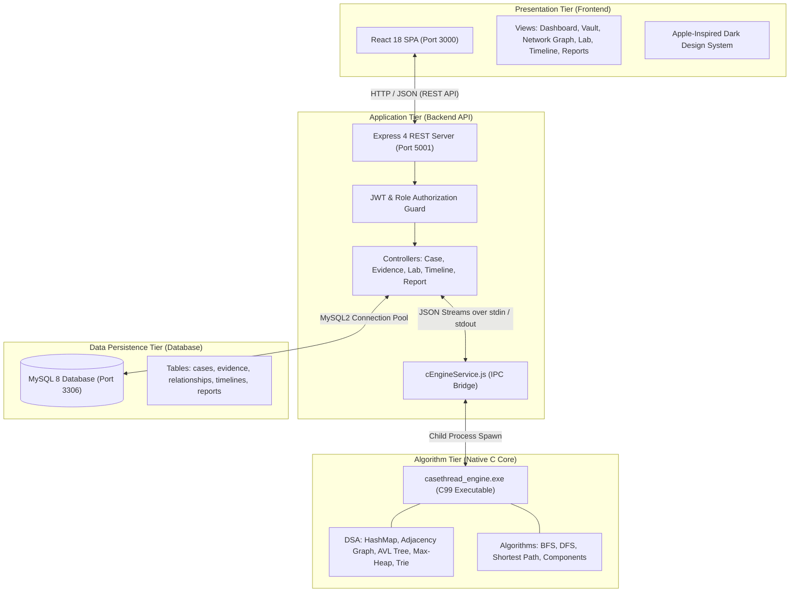
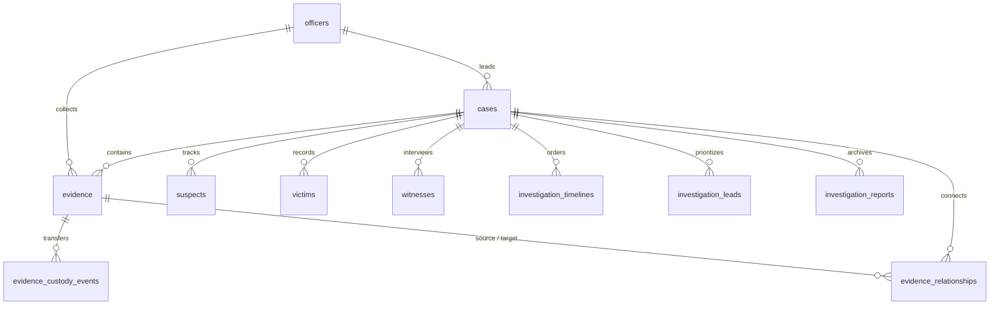
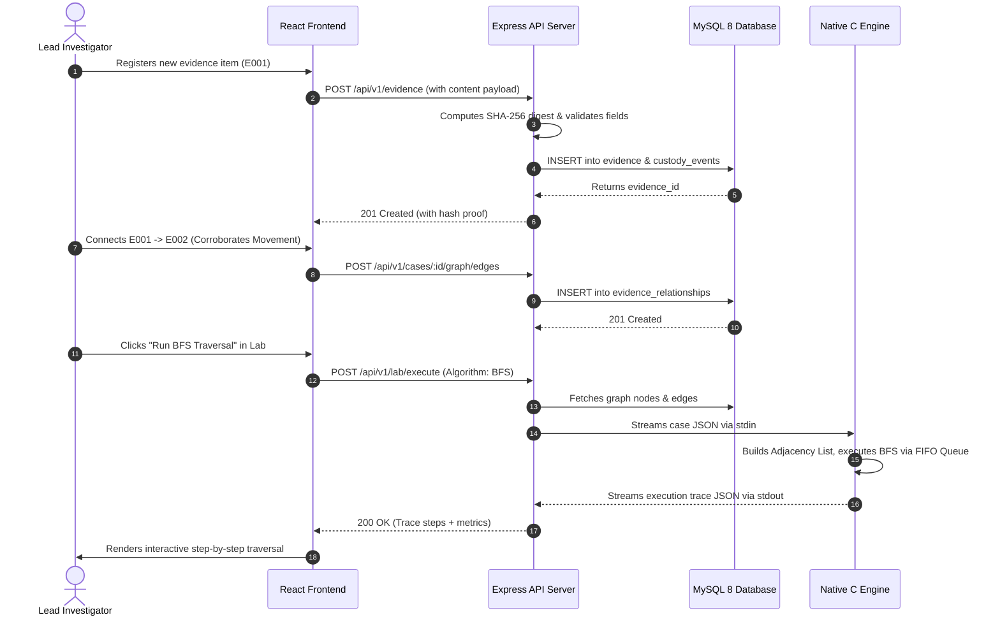

# CASETHREAD — SYSTEM ARCHITECTURE
## Technical Architecture & End-to-End Data Flow

---

## 1. High-Level System Architecture

CaseThread follows a three-tier architecture augmented with a native C compiled core engine connected via Inter-Process Communication (IPC):

---

## 2. Native C Algorithm Engine & IPC Protocol

The Native C engine is compiled as a standalone binary (`core-engine/bin/casethread_engine.exe`) with zero third-party dependencies, written in standard ISO C99.

### 2.1. IPC Communication Protocol
1. **Payload Marshaling:** When an investigator triggers an analysis or lab execution, Node.js (`backend/services/cEngineService.js`) queries the relevant MySQL records and formats a normalized JSON payload containing vertices (entities, evidence) and directed edges.
2. **Process Spawning:** Node.js invokes `spawn('casethread_engine.exe', ['--stdin'])`.
3. **Stream Transmission:** The JSON payload is written directly to the child process's standard input (`stdin`), followed by stream termination (`stdin.end()`).
4. **Execution in C:**
   - The C engine parses the input into an in-memory **Adjacency List** and **Separate-Chaining HashMap**.
   - Traversal and partitioning algorithms (BFS, DFS, Connected Components, AVL rebalancing) execute in pure C with manual pointer manipulation and heap allocation (`malloc`/`free`).
   - Every algorithmic step (e.g., `QUEUE_ENQUEUE`, `QUEUE_DEQUEUE`, `VISIT_NODE`, `BACKTRACK`) is recorded in an execution trace buffer.
5. **Output Serialization:** The engine streams structured result JSON to standard output (`stdout`). Diagnostics and assertions route to standard error (`stderr`), keeping `stdout` strictly parseable.
6. **Persistence & Response:** Node.js buffers `stdout`, parses the JSON result, records execution latency metrics (typically 1–8 milliseconds), and returns the payload to the frontend.

---

## 3. Database Architecture & Schema Design

The database layer utilizes MySQL 8 with the InnoDB storage engine, foreign key enforcement, and indexes optimized for forensic queries:

### Key Tables & Integrity Rules:
- `cases`: Master investigation record with `case_number`, status, priority, incident timestamp, and assigned lead officer.
- `evidence`: Evidentiary registry with `tracking_code` (unique barcode), `sha256_fingerprint`, collection metadata, and categorical classification.
- `evidence_relationships`: Explicit network edges with `source_id`, `target_id`, `relation_type`, `confidence_weight` (0.0 to 1.0), and `relationship_nature` (`CONFIRMED_FACT` vs `UNVERIFIED_OBSERVATION`).
- `evidence_custody_events`: Immutable transfer ledger recording releasing/receiving officers, locations, transfer reasons, and block-level `state_hash_sha256`.
- `investigation_timelines`: Unified chronological events with precision flags (`EXACT_SEC`, `MINUTE_ESTIMATE`, `DAY_APPROX`) and verification status.
- `investigation_leads`: Prioritized investigative hypotheses ordered by numeric `priority_score` (backed by the Max-Heap structure).
- `investigation_reports`: Persisted archive of generated dossiers, format types (PDF, CSV, JSON), and included section masks.

---

## 4. End-to-End Evidence Data Flow

---

## 5. Security & Production Hardening

1. **Authentication & Authorization:**
   - Passwords hashed using `bcrypt` with 12 salt rounds.
   - Stateless JWT tokens signed with SHA-256 HMAC and configured expiration.
   - Role-Based Access Control (RBAC) protecting critical case modification and report generation endpoints.
2. **SQL Injection Defense:**
   - 100% of database queries use parameterized SQL prepared statements (`execute(sql, params)`).
3. **Formula Injection (CSV/DDE Shield):**
   - The CSV export engine neutralizes Excel/Calc formula execution triggers (`=, +, -, @, \t, \r`) by prefixing vulnerable cells with a safe literal single quote (`'`).
4. **Print Paged Media Styling:**
   - Report Center PDF generation uses native browser print engines styled with CSS Paged Media (`@page { margin: 1.6cm; size: A4; }`, `page-break-inside: avoid;`), ensuring high-resolution vector output without clipped tables or third-party binary renderer vulnerabilities.
